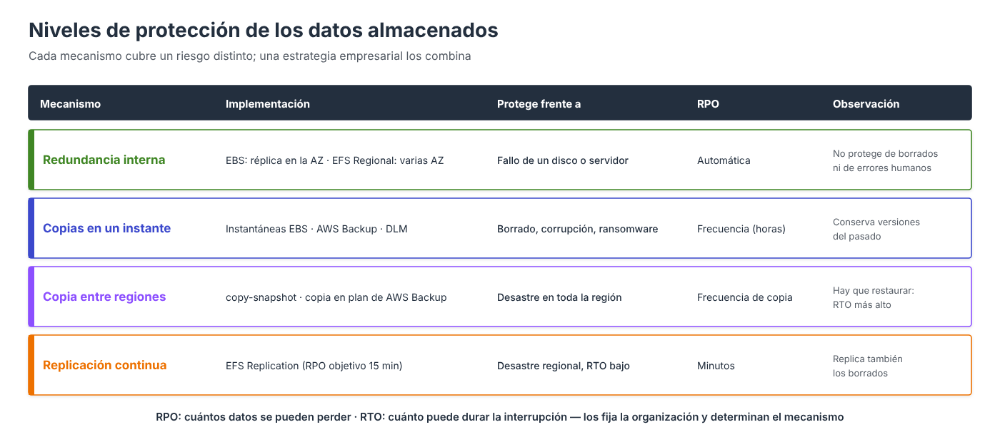

# Copias de seguridad y recuperación



El criterio de evaluación pide configurar copias y replicación de forma que se pueda **recuperar en la forma y el tiempo especificados**. Hay que partir de dos requisitos medibles y elegir el mecanismo que los cumple.

| Requisito | Pregunta | Determina |
| --- | --- | --- |
| **RPO** (*Recovery Point Objective*) | ¿Cuántos datos, medidos en tiempo, se pueden perder? | La **frecuencia** de las copias |
| **RTO** (*Recovery Time Objective*) | ¿Cuánto tiempo puede estar el servicio parado? | El **mecanismo** de recuperación |

---

## Mecanismos

| Mecanismo | Servicio | RPO típico | Protege frente a |
| --- | --- | --- | --- |
| Instantánea manual | EBS | El de la última copia | Error en un cambio planificado |
| **Data Lifecycle Manager (DLM)** | EBS | Horas | Borrados, corrupción |
| **AWS Backup** | EBS, EFS y otros | Horas | Borrados, corrupción |
| Copia a otra región | EBS (instantáneas), EFS (AWS Backup) | Horas | Desastre en toda la región |
| **EFS Replication** | EFS | Minutos | Desastre regional, con RTO bajo |

Las copias conservan **versiones del pasado** y recuperan lo borrado. La replicación mantiene una réplica **actual**: recupera rápido tras un desastre, pero **también replica los borrados**. Por eso se combinan.

---

## Amazon Data Lifecycle Manager (DLM)

DLM automatiza las **instantáneas de EBS**. Una **política de ciclo de vida** selecciona los volúmenes **por etiqueta** y define cada cuánto se crean instantáneas y cuántas se conservan. Las más antiguas se borran solas.

=== "Consola AWS"

    1. Etiquetar el volumen que se quiere proteger, por ejemplo `backup = diario`.
    2. **EC2 → Elastic Block Store → Administrador del ciclo de vida → Crear política de ciclo de vida**.
    3. **Política de instantáneas de EBS** → **Siguiente**.
    4. **Tipos de recursos de destino**: *Volumen*. **Etiquetas de recursos de destino**: `backup = diario`.
    5. **Descripción**, **rol de IAM** (en el Learner Lab, *Elegir otro rol* → `LabRole`) y **estado**: *Habilitada*. **Siguiente**.
    6. **Programación**: frecuencia *Diaria*, *Cada 12 horas*, *A partir de* `03:00` UTC; **retención** por *recuento*: `14`.
    7. **Revisar política → Crear política**.

    El paso a paso completo se hace en la práctica 1.

=== "AWS CLI"

    ```bash
    aws dlm create-lifecycle-policy \
      --description "Cada 12 h, volumenes con backup=diario" \
      --state ENABLED \
      --execution-role-arn arn:aws:iam::111122223333:role/LabRole \
      --policy-details '{
        "PolicyType": "EBS_SNAPSHOT_MANAGEMENT",
        "ResourceTypes": ["VOLUME"],
        "TargetTags": [{"Key": "backup", "Value": "diario"}],
        "Schedules": [{
          "Name": "Cada12Horas",
          "CopyTags": true,
          "CreateRule": {"Interval": 12, "IntervalUnit": "HOURS", "Times": ["03:00"]},
          "RetainRule": {"Count": 14}
        }]
      }'
    ```

Con esta política, el **RPO** es de 12 horas y se pueden recuperar estados de los últimos 7 días. La primera instantánea se crea **dentro de la hora siguiente** a la hora de inicio.

---

## AWS Backup

**AWS Backup** centraliza las copias de EBS, EFS, RDS, DynamoDB y otros servicios. Un **plan de copia** define la frecuencia, la retención y, si se desea, la copia a otra región, y se asigna a los recursos **por etiqueta**. Las copias se guardan en un **almacén** (*backup vault*) y cada una es un **punto de recuperación** desde el que se restaura.

En EFS, el asistente de creación activa por defecto un plan **diario con 35 días de retención**. Su uso y la restauración se ven en [Copias de seguridad y replicación de EFS](EFS-08.md).

---

## Comprobar la recuperación

Una copia que nunca se ha restaurado **no es una copia fiable**:

- **Restaurar periódicamente** y comprobar que los datos están completos: crear un volumen desde una instantánea, montarlo y revisar los ficheros, como en la práctica 1.
- **Medir el tiempo** de restauración y compararlo con el **RTO**.
- **Comprobar la antigüedad** de la última copia frente al **RPO**.

!!! info "Para saber más"
    La [ampliación de copias de seguridad](AMP-Copias.md) incluye planes de AWS Backup paso a paso, copias inmutables, el nivel de archivo, la papelera de reciclaje, el bloqueo de instantáneas y la conmutación por error de EFS.

---

## Referencias

- AWS. *Amazon Data Lifecycle Manager* — [DLM](https://docs.aws.amazon.com/ebs/latest/userguide/snapshot-lifecycle.html)
- AWS. *Create a custom snapshot policy* — [Política de instantáneas](https://docs.aws.amazon.com/ebs/latest/userguide/snapshot-ami-policy.html)
- AWS. *What is AWS Backup?* — [Guía de AWS Backup](https://docs.aws.amazon.com/aws-backup/latest/devguide/whatisbackup.html)
