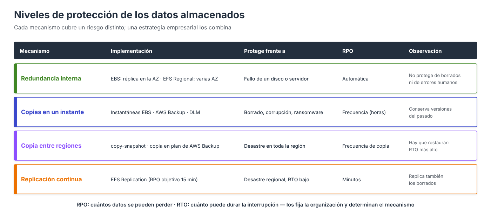

# Copias de seguridad y recuperación (ampliación)



!!! info "Contenido de ampliación"
    Esta página es **opcional**. Recoge la versión completa del apartado del núcleo y amplía sus contenidos. No es necesaria para realizar las prácticas.

El último criterio de evaluación pide configurar «los mecanismos de replicación y copia de seguridad de los dispositivos y/o ficheros, asegurando que se puede **recuperar en la forma y tiempo que se especifique**». Configurar copias no basta: hay que partir de **requisitos medibles**, elegir los mecanismos que los cumplen y **comprobar** que la recuperación funciona.

---

## Requisitos: RPO y RTO

| Requisito | Pregunta | Ejemplo |
| --- | --- | --- |
| **RPO** (*Recovery Point Objective*) | ¿Cuántos datos, medidos en tiempo, se pueden perder? | «Como mucho, el trabajo de las últimas 4 horas» |
| **RTO** (*Recovery Time Objective*) | ¿Cuánto tiempo puede estar el servicio sin funcionar? | «El servicio debe estar operativo en menos de 1 hora» |
| **Retención** | ¿Durante cuánto tiempo hay que conservar las copias? | 7 diarias, 4 semanales, 12 mensuales; 5 años por normativa |
| **Ubicación** | ¿Dónde deben guardarse? | En otra región de la UE, en otra cuenta |
| **Forma** | ¿Qué hay que poder recuperar? | El volumen completo, un fichero suelto, el servidor entero |

El **RPO** determina la **frecuencia** de las copias (o la replicación continua) y el **RTO**, el **mecanismo** de recuperación: restaurar una copia lleva más tiempo que montar una réplica ya preparada.

---

## Mecanismos disponibles

| Mecanismo | EBS | EFS | RPO típico | Protege frente a |
| --- | --- | --- | --- | --- |
| Instantánea manual | `create-snapshot` | — | El de la última copia | Error antes de un cambio planificado |
| **Amazon Data Lifecycle Manager** | Instantáneas y AMI programadas | — | Horas | Borrados, corrupción |
| **AWS Backup** | Sí | Sí | Horas (hasta 1 h) | Borrados, corrupción, *ransomware* (con Vault Lock) |
| Copia a otra región | `copy-snapshot`, DLM, AWS Backup | AWS Backup | Horas | Desastre regional |
| **EFS Replication** | — | Sí | Minutos (objetivo 15) | Desastre regional, con RTO bajo |

---

## Amazon Data Lifecycle Manager (DLM)

DLM automatiza la creación, la retención, la copia y la eliminación de **instantáneas de EBS** (y de AMI) mediante **políticas de ciclo de vida** que seleccionan los recursos **por etiquetas**.

| Elemento de la política | Ejemplo |
| --- | --- |
| **Recursos de destino** | Volúmenes (o instancias) con la etiqueta `backup=diario` |
| **Programación** | Cada 12 horas a partir de las 03:00 UTC |
| **Retención** | Conservar las 14 últimas (o las de los últimos 7 días) |
| **Etiquetas de las instantáneas** | Copiar las etiquetas del volumen y añadir `creado-por=dlm` |
| **Copia entre regiones** | Copiar a `us-west-2`, cifrada, con retención de 30 días |
| **Archivo** | Pasar al nivel archive las instantáneas mensuales |
| **Rol de IAM** | Rol que DLM asume para crear y borrar instantáneas |

=== "Consola AWS"

    1. **EC2 → Elastic Block Store → Administrador del ciclo de vida → Crear política de ciclo de vida**.
    2. **Tipo de política**: *Política personalizada* → **Política de instantáneas de EBS**.
    3. **Recursos de destino**: *Volumen*, con la etiqueta `backup = diario`.
    4. **Rol de IAM**: el predeterminado o, en el Learner Lab, `LabRole`. **Estado**: *Habilitado*.
    5. **Programación 1**: frecuencia *Cada 12 horas* a partir de las `03:00` UTC; retención por **recuento** `14`; marcar **Copiar etiquetas del origen** y añadir `creado-por = dlm`.
    6. En **Copia entre regiones**, habilitar la copia a `us-west-2`, cifrada, con retención de 30 días.
    7. **Revisar política → Crear política**.

=== "AWS CLI"

    ```bash
    aws dlm create-lifecycle-policy \
      --description "Instantaneas cada 12 h de los volumenes con backup=diario" \
      --state ENABLED \
      --execution-role-arn arn:aws:iam::111122223333:role/LabRole \
      --policy-details file://politica-dlm.json

    aws dlm get-lifecycle-policies \
      --query "Policies[].[PolicyId,Description,State]" --output table
    ```

    `politica-dlm.json` contiene el mismo bloque `PolicyDetails` que la plantilla siguiente, en formato JSON.

Como infraestructura como código:

```yaml
PoliticaInstantaneas:
  Type: AWS::DLM::LifecyclePolicy
  Properties:
    Description: Instantaneas cada 12 h de los volumenes con backup=diario
    State: ENABLED
    ExecutionRoleArn: !Sub arn:aws:iam::${AWS::AccountId}:role/LabRole   # en una cuenta real, AWSDataLifecycleManagerDefaultRole
    PolicyDetails:
      PolicyType: EBS_SNAPSHOT_MANAGEMENT
      ResourceTypes: [VOLUME]
      TargetTags:
        - { Key: backup, Value: diario }
      Schedules:
        - Name: Cada12Horas
          CopyTags: true
          TagsToAdd:
            - { Key: creado-por, Value: dlm }
          CreateRule:
            Interval: 12
            IntervalUnit: HOURS
            Times: ["03:00"]
          RetainRule:
            Count: 14
          CrossRegionCopyRules:
            - Target: us-west-2
              Encrypted: true
              RetainRule:
                Interval: 30
                IntervalUnit: DAYS
```

Con esta política, el **RPO** frente a un error es de **12 horas** como máximo, y se pueden recuperar estados de los **últimos 7 días**.

---

## AWS Backup

**AWS Backup** centraliza las copias de varios servicios con un único modelo:

| Concepto | Descripción |
| --- | --- |
| **Almacén** (*backup vault*) | Contenedor cifrado donde se guardan los puntos de recuperación |
| **Plan de copia** (*backup plan*) | Una o varias **reglas**: frecuencia, ventana, ciclo de vida, retención y copias |
| **Asignación de recursos** | Qué recursos protege el plan: por ARN o, mejor, **por etiquetas** |
| **Punto de recuperación** | Cada copia realizada, desde la que se restaura |
| **Vault Lock** | Hace las copias **inmutables**: nadie puede borrarlas ni acortar su retención |
| **Restore testing** | Restauraciones de prueba programadas para validar que las copias sirven |

Ejemplo de plan que cubre EBS y EFS etiquetados con `backup=diario`: copia diaria con retención de 35 días, copia mensual con retención de un año pasando a almacenamiento en frío, y copia de las diarias a otra región.

```json
{
  "BackupPlanName": "plan-almacenamiento-ud3",
  "Rules": [
    {
      "RuleName": "Diaria",
      "TargetBackupVaultName": "almacen-produccion",
      "ScheduleExpression": "cron(0 3 * * ? *)",
      "StartWindowMinutes": 60,
      "CompletionWindowMinutes": 480,
      "Lifecycle": { "DeleteAfterDays": 35 },
      "CopyActions": [
        {
          "DestinationBackupVaultArn": "arn:aws:backup:us-west-2:111122223333:backup-vault:almacen-dr",
          "Lifecycle": { "DeleteAfterDays": 35 }
        }
      ]
    },
    {
      "RuleName": "Mensual",
      "TargetBackupVaultName": "almacen-produccion",
      "ScheduleExpression": "cron(0 4 1 * ? *)",
      "Lifecycle": { "MoveToColdStorageAfterDays": 30, "DeleteAfterDays": 365 }
    }
  ]
}
```

=== "Consola AWS"

    **Almacén**

    1. **AWS Backup → Almacenes → Crear almacén**: nombre `almacen-produccion` y clave de cifrado. **Crear almacén**.

    **Plan de copia**

    1. **AWS Backup → Planes de copia de seguridad → Crear plan de copia de seguridad → Crear un plan nuevo**. Nombre: `plan-almacenamiento-ud3`.
    2. **Regla «Diaria»**: almacén `almacen-produccion`; frecuencia *Diaria* a las 03:00 UTC; ventana de inicio 1 hora y de finalización 8 horas; **retención** 35 días; en **Copiar a destino**, la región `us-west-2` y el almacén `almacen-dr` con retención de 35 días.
    3. **Agregar regla «Mensual»**: frecuencia *Mensual*, día 1; **Ciclo de vida**: pasar a almacenamiento en frío a los 30 días y eliminar a los 365.
    4. **Crear plan**.

    **Asignación de recursos**

    1. En el plan, **Asignar recursos**: nombre `recursos-etiquetados`; rol predeterminado o `LabRole`.
    2. **Definir la selección de recursos**: *Incluir tipos de recursos específicos* (EBS y EFS) y, en **Refinar la selección mediante etiquetas**, `backup = diario`.
    3. **Asignar recursos**.

    **Copia bajo demanda** (por ejemplo, antes de un cambio): **AWS Backup → Recursos protegidos → Crear copia de seguridad bajo demanda**, elegir el tipo de recurso, el ID, el almacén y la retención.

=== "AWS CLI"

    ```bash
    aws backup create-backup-vault --backup-vault-name almacen-produccion
    PLAN=$(aws backup create-backup-plan --backup-plan file://plan.json --query BackupPlanId --output text)

    aws backup create-backup-selection --backup-plan-id "$PLAN" --backup-selection '{
      "SelectionName": "recursos-etiquetados",
      "IamRoleArn": "arn:aws:iam::111122223333:role/LabRole",
      "ListOfTags": [{"ConditionType":"STRINGEQUALS","ConditionKey":"backup","ConditionValue":"diario"}]
    }'

    # Copia bajo demanda (por ejemplo, antes de un cambio)
    aws backup start-backup-job --backup-vault-name almacen-produccion \
      --resource-arn arn:aws:elasticfilesystem:us-east-1:111122223333:file-system/fs-0abc123 \
      --iam-role-arn arn:aws:iam::111122223333:role/LabRole
    ```

!!! note "DLM o AWS Backup"
    Para EBS ambos sirven. **DLM** es específico de EBS, sencillo y sin coste adicional más allá de las instantáneas. **AWS Backup** es preferible cuando se quiere **una única política para todos los servicios** (EBS, EFS, RDS…), copias inmutables, informes de cumplimiento o copias entre cuentas. No conviene usar ambos sobre los mismos volúmenes, porque se duplican las instantáneas.

!!! warning "Learner Lab"
    En el Learner Lab algunas operaciones de DLM y AWS Backup pueden estar limitadas por los permisos del laboratorio. En ese caso se usa `LabRole` como rol de ejecución o se realizan las copias bajo demanda.

---

## Procedimientos de recuperación

### EBS: recuperar un volumen de datos

1. Localizar la instantánea adecuada (fecha anterior al incidente).
2. Crear un **volumen nuevo** desde ella **en la AZ de la instancia**.
3. Adjuntarlo a la instancia con otro nombre de dispositivo.
4. **Montarlo en otro directorio** (por ejemplo, `/restaurado`), si se quiere en **solo lectura**, para copiar solo lo necesario; o sustituir el volumen dañado por el restaurado.

=== "Consola AWS"

    1. **EC2 → Instantáneas**, filtrar por **ID de volumen** y ordenar por **Iniciado** para localizar la instantánea anterior al incidente.
    2. **Acciones → Crear volumen a partir de una instantánea**, en la AZ de la instancia (`us-east-1a`), tipo `gp3`.
    3. **Volúmenes** → seleccionar el volumen nuevo → **Acciones → Asociar volumen** a la instancia, con el dispositivo `/dev/sdg`.

=== "AWS CLI"

    ```bash
    aws ec2 describe-snapshots --owner-ids self \
      --filters Name=volume-id,Values=vol-0abc... \
      --query "sort_by(Snapshots,&StartTime)[].[SnapshotId,StartTime,Description]" --output table

    aws ec2 create-volume --snapshot-id snap-0abc... --availability-zone us-east-1a --volume-type gp3
    aws ec2 attach-volume --volume-id vol-0rest... --instance-id i-0123... --device /dev/sdg
    ```

En la instancia (en `xfs`, `nouuid` evita el conflicto con el UUID del volumen original montado):

```bash
sudo mkdir /restaurado
sudo mount -o ro,nouuid /dev/nvme2n1 /restaurado
```

### EBS: recuperar en otra región

Se copia (o ya estaba copiada por DLM/AWS Backup) la instantánea a la región de destino, se crea el volumen allí y se adjunta a una instancia de esa región, que puede lanzarse desde una AMI también copiada.

### EFS: recuperar ficheros borrados

Con AWS Backup se lanza una **restauración parcial** de las rutas afectadas sobre el mismo sistema de archivos: aparecen en `/aws-backup-restore_<fecha>/`, desde donde se copian a su ubicación.

### EFS: desastre regional

Con **EFS Replication**, se elimina la configuración de replicación y se montan los clientes de la región secundaria sobre el sistema de destino, que pasa a lectura/escritura (ver el apartado de copias y replicación de EFS).

---

## Comprobar la recuperación

Una copia que nunca se ha restaurado **no es una copia fiable**. Para asegurar que se puede recuperar «en la forma y tiempo que se especifique»:

- **Restaurar periódicamente** (o con *restore testing* de AWS Backup) y comprobar que los datos son íntegros y la aplicación arranca.
- **Medir el tiempo** de la restauración completa y compararlo con el **RTO**. Si no se cumple, cambiar de mecanismo (por ejemplo, *Fast Snapshot Restore* o replicación).
- **Comprobar la antigüedad** de la última copia o sincronización frente al **RPO** (`TimeSinceLastSync`, informes de AWS Backup, alarmas sobre trabajos fallidos).
- **Documentar** el procedimiento paso a paso para que pueda ejecutarlo cualquier miembro del equipo.

| Requisito de ejemplo | Solución que lo cumple |
| --- | --- |
| Volumen de datos web, RPO 24 h, RTO 4 h, 30 días de historial | DLM o AWS Backup diario, retención 30 |
| Contenidos EFS, RPO 1 h ante errores, recuperación de ficheros sueltos | AWS Backup cada hora, restauración parcial |
| Contenidos EFS, sobrevivir a la caída de la región con RTO 30 min | EFS Replication a otra región **+** AWS Backup (los borrados se replican) |
| Conservar 5 años un volumen de facturación por normativa | Instantánea mensual en nivel archive, o AWS Backup con almacenamiento en frío y Vault Lock |

---

## Funcionalidades avanzadas de las instantáneas

| Funcionalidad | Para qué sirve | Consideraciones |
| --- | --- | --- |
| **Nivel de archivo** (*EBS Snapshots Archive*) | Guardar instantáneas que se conservan mucho tiempo y casi nunca se restauran (normativa, cierres anuales) | Almacenamiento hasta un **75 % más barato**; permanencia mínima de **90 días**; restaurar tarda entre **24 y 72 horas** y tiene coste |
| **Papelera de reciclaje** (*Recycle Bin*) | Recuperar instantáneas y AMI **borradas por error** | Se definen reglas de retención (por ejemplo, conservar 7 días lo borrado) |
| **Bloqueo de instantáneas** (*Snapshot Lock*) | Impedir que nadie, ni siquiera un administrador, borre una instantánea durante un periodo | Modo *governance* (los usuarios con permiso pueden desbloquear) o *compliance* (inmutable); protege frente a *ransomware* |
| **Restauración rápida** (*Fast Snapshot Restore*) | Que los volúmenes creados desde una instantánea ofrezcan **todo su rendimiento desde el primer momento** | Se activa por instantánea y AZ y tiene coste por hora |
| **Compartir instantáneas** | Usar una instantánea en otra cuenta de AWS | Las cifradas con la clave **administrada por AWS** no se pueden compartir; hace falta una clave del cliente |
| **Bloqueo del acceso público** | Impedir a nivel de región que las instantáneas se compartan públicamente | Muy recomendable: una instantánea pública expone todo el disco |

!!! note "Inicialización de volúmenes restaurados"
    Un volumen creado desde una instantánea está disponible de inmediato, pero sus bloques se descargan del almacenamiento de instantáneas **la primera vez que se leen**. Ese primer acceso tiene más latencia. Si se necesita el rendimiento completo desde el principio (por ejemplo, al restaurar una base de datos de producción), se activa *Fast Snapshot Restore* o se leen previamente todos los bloques con herramientas como `fio` o `dd`.

---

---

## EFS: conmutación por error (*failover*) y vuelta (*failback*)

1. **Incidencia** en la región de origen.
2. Se **elimina la configuración de replicación**. El sistema de destino deja de ser de solo lectura y **admite escritura**: se convierte en el nuevo sistema principal.
3. Las aplicaciones de la región secundaria lo **montan** y continúan el servicio.
4. Resuelta la incidencia, se configura la replicación **en sentido inverso**, desde el nuevo principal hacia el sistema original (desactivando su protección contra sobrescritura), para **sincronizar los cambios de vuelta**.
5. Se repite la conmutación hacia la región original y se restablece la replicación inicial.

=== "Consola AWS"

    **Failover**

    1. En la pestaña **Replicación** del sistema de origen (o del de destino), pulsar **Eliminar replicación** y confirmar.
    2. El sistema de destino pasa de *Solo lectura* a **Grabable**.

    **Failback**

    1. En el sistema **original** (`eu-west-1`): **General → Editar** y desactivar la **Protección contra la sobrescritura de la replicación**. **Guardar cambios**.
    2. En el nuevo principal (`eu-south-2`): pestaña **Replicación → Crear replicación**, con destino **Sistema de archivos existente** `fs-0abc123` en `eu-west-1`.
    3. Cuando esté sincronizado, repetir la conmutación hacia la región original.

=== "AWS CLI"

    ```bash
    # Failover: detener la replicación (el destino pasa a lectura/escritura)
    aws efs delete-replication-configuration --source-file-system-id fs-0abc123

    # Failback: permitir que el sistema original reciba la réplica inversa
    aws efs update-file-system-protection --file-system-id fs-0abc123 \
      --replication-overwrite-protection DISABLED
    aws efs create-replication-configuration --region eu-south-2 \
      --source-file-system-id fs-0def456 \
      --destinations Region=eu-west-1,FileSystemId=fs-0abc123
    ```

---

## Referencias

- AWS. *Amazon Data Lifecycle Manager* — [DLM](https://docs.aws.amazon.com/ebs/latest/userguide/snapshot-lifecycle.html)
- AWS CloudFormation. *AWS::DLM::LifecyclePolicy* — [Referencia](https://docs.aws.amazon.com/AWSCloudFormation/latest/TemplateReference/aws-resource-dlm-lifecyclepolicy.html)
- AWS. *What is AWS Backup?* — [Guía de AWS Backup](https://docs.aws.amazon.com/aws-backup/latest/devguide/whatisbackup.html)
- AWS. *Backup plans* — [Planes de copia](https://docs.aws.amazon.com/aws-backup/latest/devguide/about-backup-plans.html)
- AWS. *AWS Backup Vault Lock* — [Copias inmutables](https://docs.aws.amazon.com/aws-backup/latest/devguide/vault-lock.html)
- AWS. *Restore testing* — [Pruebas de restauración](https://docs.aws.amazon.com/aws-backup/latest/devguide/restore-testing.html)
- AWS Whitepaper. *Disaster Recovery of Workloads on AWS* — [Recuperación ante desastres](https://docs.aws.amazon.com/whitepapers/latest/disaster-recovery-workloads-on-aws/disaster-recovery-workloads-on-aws.html)
