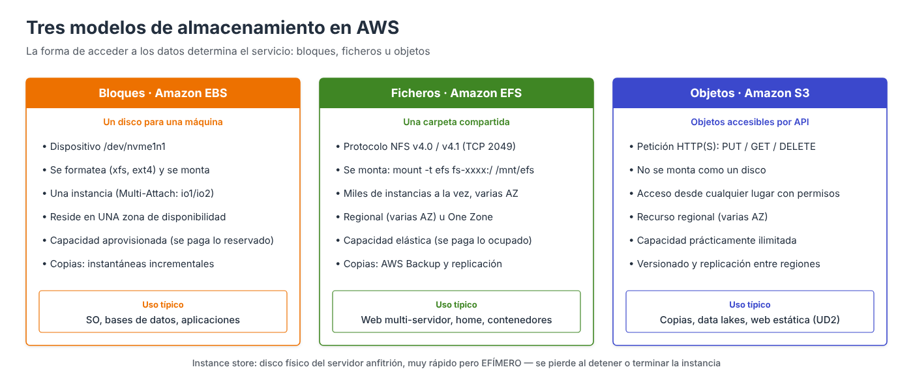
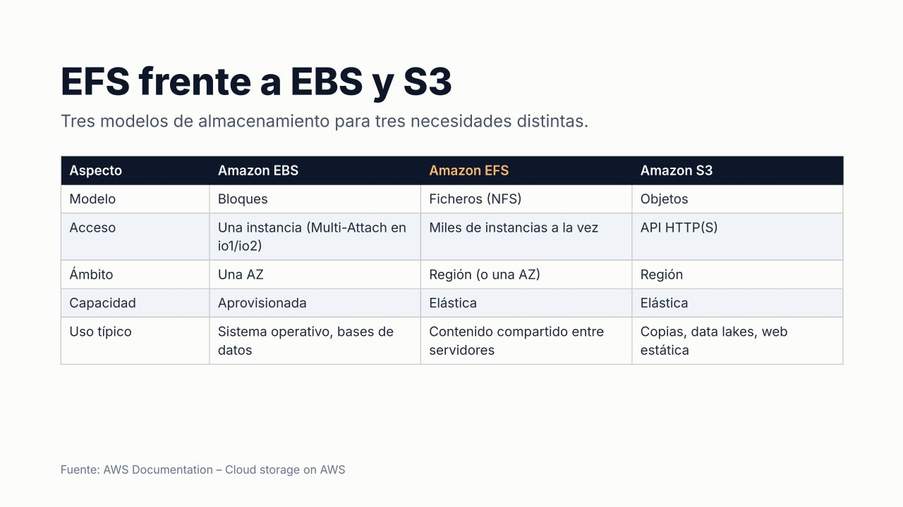

# Bloques, ficheros y objetos

AWS no ofrece «un disco» genérico, sino varios servicios de almacenamiento con **modelos de acceso distintos**. Elegir el adecuado condiciona el rendimiento, la disponibilidad y, sobre todo, el **coste**. Esta unidad estudia los dos servicios de almacenamiento **montable** en una máquina virtual: **Amazon EBS** (bloques) y **Amazon EFS** (ficheros). Junto a **Amazon S3** (objetos), estudiado en la unidad anterior, completan los tres modelos.

---

## Los tres modelos

| Modelo | Cómo se accede | Servicio | Equivale a |
| --- | --- | --- | --- |
| **Bloques** | El sistema operativo ve un disco, lo formatea (`xfs`, `ext4`) y lo monta | **Amazon EBS** | Un disco duro o SSD conectado al servidor |
| **Ficheros** | Varios clientes montan por red un sistema de archivos con directorios y permisos (NFS) | **Amazon EFS** | Un servidor de ficheros o una cabina NAS |
| **Objetos** | Peticiones HTTP(S) a una API (`PUT`, `GET`, `DELETE`); no se monta | **Amazon S3** | Un almacén ilimitado accesible desde cualquier lugar |

| Aspecto | Amazon EBS | Amazon EFS | Amazon S3 |
| --- | --- | --- | --- |
| **Acceso** | Una instancia EC2 | Miles de clientes a la vez | API desde cualquier lugar |
| **Ámbito** | **Una zona de disponibilidad** | Región (varias AZ) o una sola AZ | Región |
| **Capacidad** | **Aprovisionada**: se paga el tamaño reservado | **Elástica**: se paga lo ocupado | Elástica |
| **Sistema operativo** | Linux y Windows | Linux (para Windows: Amazon FSx) | Independiente |
| **Uso típico** | Disco de arranque, bases de datos | Contenido compartido entre servidores | Copias, web estática, lagos de datos |

!!! tip "Regla práctica"
    **Un disco para una máquina** → EBS. **Una carpeta compartida entre varias máquinas** → EFS. **Objetos accesibles mediante una API** → S3.

!!! note "Almacén de instancia (*instance store*)"
    Algunos tipos de instancia incluyen discos **físicos del servidor anfitrión**. Son muy rápidos, pero **efímeros**: se pierden al detener o terminar la instancia. Solo sirven para datos temporales (cachés, ficheros intermedios).

---

## Criterios de selección

| Criterio | Pregunta | Orientación |
| --- | --- | --- |
| **Requisito funcional** | ¿Disco, carpeta compartida o API? | EBS · EFS · S3 |
| **Patrón de acceso** | ¿Aleatorio o secuencial? ¿Frecuente u ocasional? | SSD (`gp3`, `io2`) · HDD (`st1`, `sc1`) · EFS IA/Archive para datos fríos |
| **Disponibilidad** | ¿Debe sobrevivir a la caída de una zona? | EBS vive en una AZ · EFS Regional abarca varias |
| **Coste de almacenamiento** | ¿Se paga lo reservado o lo ocupado? | EBS: reservado · EFS y S3: ocupado |
| **Coste de recuperación** | ¿Cuesta leer o restaurar los datos? | EFS IA y Archive cobran por cada lectura |
| **Ubicación** | ¿Deben permanecer los datos en una región o país? | Se elige la región y se controla la copia a otras |

### Región y zona de disponibilidad

- Un **volumen EBS existe en una zona de disponibilidad** y solo se adjunta a instancias de esa zona. Para llevarlo a otra zona o región se usan las **instantáneas**.
- Un **sistema de archivos EFS Regional** guarda los datos en varias zonas; la variante **One Zone** es más barata pero depende de una sola.
- Las **instantáneas y las copias son regionales**: para tenerlas en otra región hay que copiarlas. EFS permite además **replicación continua** entre regiones.

La región se elige por **latencia** respecto a los usuarios, **residencia de los datos** (RGPD), **disponibilidad** de los servicios y **precio**.

---

## Referencias

- AWS. *Choosing an AWS storage service* — [Guía de decisión](https://docs.aws.amazon.com/decision-guides/latest/storage-on-aws-how-to-choose/choosing-aws-storage-service.html)
- AWS. *Instance store temporary block storage* — [Almacén de instancia](https://docs.aws.amazon.com/AWSEC2/latest/UserGuide/InstanceStorage.html)
