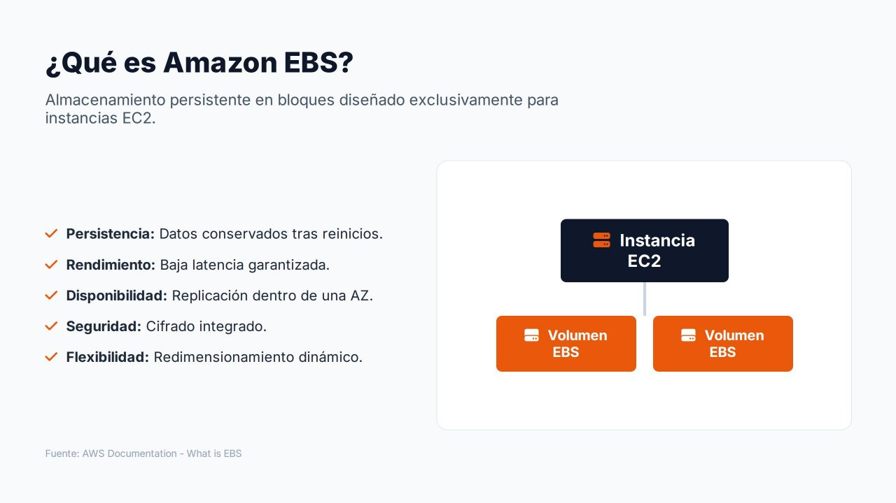
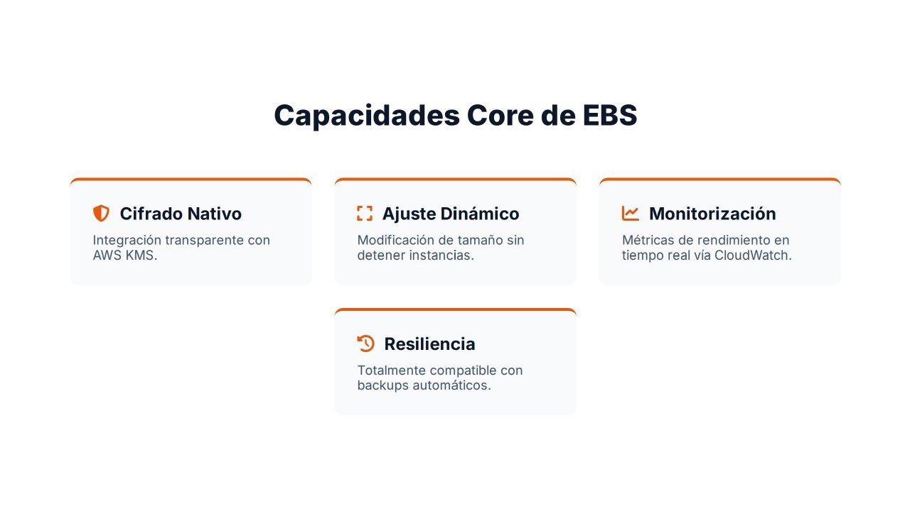

# Amazon EBS: visión general y capacidades

Cuando se despliega una instancia EC2 se necesita un lugar donde almacenar **de forma permanente** el sistema operativo, las aplicaciones, las bases de datos y los datos de usuario. La memoria RAM pierde su contenido al apagarse la máquina y el almacén de instancia desaparece cuando esta se detiene o se reemplaza. Hace falta, por tanto, un almacenamiento **persistente y fiable**.

**Amazon Elastic Block Store (Amazon EBS)** proporciona **volúmenes**: discos virtuales que se conectan a las instancias EC2 de forma muy similar a como se conectaría un SSD físico a un servidor. El sistema operativo detecta el volumen como un dispositivo de bloques normal sobre el que se crean particiones y sistemas de ficheros.

Este apartado presenta las características del servicio. Los siguientes estudian los **tipos de volúmenes**, las **instantáneas**, las funcionalidades avanzadas **Multi-Attach** y **reservas NVMe** y el **ciclo de vida** completo de un volumen.

---

## Características principales

| Característica | Descripción |
| --- | --- |
| **Persistencia** | Los datos se conservan aunque la instancia se reinicie o se detenga. El volumen existe con independencia del estado de la máquina virtual |
| **Rendimiento** | Distintos tipos de volumen con niveles definidos de IOPS y rendimiento (MiB/s), desde servidores web hasta bases de datos de misión crítica |
| **Disponibilidad** | Cada volumen se **replica automáticamente dentro de su zona de disponibilidad**, lo que lo protege frente al fallo de un componente físico |
| **Seguridad** | Cifrado con **AWS KMS** de los datos en reposo, de los datos en tránsito entre la instancia y el volumen, y de las instantáneas |
| **Flexibilidad** | Se puede ampliar la capacidad y modificar el tipo y el rendimiento **sin detener la instancia** (*Elastic Volumes*) |

!!! warning "EBS es almacenamiento en bloques"
    EBS **no** es almacenamiento de objetos como Amazon S3 ni un sistema de ficheros compartido como Amazon EFS. Un volumen se conecta, en general, a **una única instancia** y reside en **una única zona de disponibilidad**. Por eso se considera uno de los pilares de la infraestructura de cómputo en AWS: cuando una instancia necesita arrancar un sistema operativo, alojar una base de datos o ejecutar una aplicación con acceso constante a disco, EBS suele ser la solución.

---

## Conceptos básicos

| Concepto | Descripción |
| --- | --- |
| **Volumen** | Disco virtual con un tamaño, un tipo y un rendimiento. Se identifica como `vol-0123456789abcdef0` |
| **Volumen raíz** | Volumen desde el que arranca la instancia. Se crea a partir de la AMI al lanzar la instancia |
| **Volumen de datos** | Volumen adicional adjuntado a la instancia para separar los datos del sistema operativo |
| **Adjuntar** (*attach*) | Conectar un volumen a una instancia **de la misma zona de disponibilidad** |
| **Nombre de dispositivo** | Nombre con el que se adjunta (`/dev/sdf`, `/dev/xvdf`). En las instancias **Nitro** el sistema operativo lo ve como dispositivo NVMe (`/dev/nvme1n1`) |
| **Instantánea** (*snapshot*) | Copia de seguridad incremental del volumen en un instante, almacenada de forma regional |
| **IOPS** | Operaciones de entrada/salida por segundo que admite el volumen |
| **Rendimiento** (*throughput*) | Cantidad de datos por segundo, en MiB/s |
| **Eliminar al terminar** (*DeleteOnTermination*) | Atributo que indica si el volumen se borra al terminar la instancia. Por defecto **sí** en el volumen raíz y **no** en los volúmenes de datos |

### Relación con la instancia

- Una instancia puede tener **varios volúmenes** adjuntos (el raíz y varios de datos).
- Un volumen se adjunta, en general, a **una sola instancia**; la excepción es **Multi-Attach**, que se estudia más adelante.
- El volumen y la instancia deben estar en la **misma zona de disponibilidad**. Para utilizar los datos en otra AZ se crea una instantánea y, a partir de ella, un volumen nuevo en la zona de destino.
- Un volumen puede **desadjuntarse** de una instancia y adjuntarse a otra, lo que resulta muy útil en operaciones de mantenimiento, migración o recuperación de incidencias (por ejemplo, para reparar el disco raíz de una instancia que no arranca).

---

## Capacidades principales

### Cifrado nativo

EBS puede cifrar los volúmenes con claves gestionadas en **AWS Key Management Service (KMS)**. El cifrado es **transparente**: el sistema operativo y las aplicaciones no necesitan ninguna modificación. Al cifrar un volumen quedan protegidos:

- Los datos **en reposo** dentro del volumen.
- Los datos **en tránsito** entre la instancia y el volumen.
- Todas las **instantáneas** creadas a partir del volumen y los volúmenes creados a partir de esas instantáneas.

El cifrado puede activarse **por defecto en cada región**, de modo que todos los volúmenes nuevos se cifren aunque nadie marque la opción. Se desarrolla en el apartado de **cifrado e infraestructura como código**.

### Ajuste dinámico de recursos (*Elastic Volumes*)

En una infraestructura tradicional, ampliar un disco implica interrupciones, sustitución de hardware o migraciones. En EBS se puede **aumentar el tamaño**, **cambiar el tipo** de volumen y **modificar las IOPS y el rendimiento** mientras el volumen está en uso. Es especialmente útil cuando una aplicación crece más rápido de lo previsto o una base de datos necesita espacio adicional.

### Monitorización integrada

EBS publica métricas en **Amazon CloudWatch** cada minuto y sin coste: operaciones de lectura y escritura, bytes transferidos, latencia media, longitud de la cola y comprobaciones que indican si la aplicación está intentando superar las IOPS o el rendimiento aprovisionados. Permiten detectar cuellos de botella y planificar la capacidad con datos reales.

### Resiliencia

La replicación interna de EBS protege frente a **fallos físicos**, pero **no** frente a errores humanos, fallos de software o la pérdida de una zona de disponibilidad. Para eso están las **instantáneas**, que permiten recuperar información borrada o restaurar sistemas a un estado anterior, y que pueden automatizarse con **Amazon Data Lifecycle Manager** o **AWS Backup**.

---

## Reparto de responsabilidades

| Tarea | Responsable |
| --- | --- |
| Hardware, replicación dentro de la AZ, durabilidad del volumen | AWS |
| Elección de la AZ, el tipo, el tamaño y el rendimiento del volumen | **Cliente** |
| Particionado, sistema de ficheros, montaje | **Cliente** (sistema operativo) |
| Ampliar el sistema de ficheros tras ampliar el volumen | **Cliente** |
| Activar el cifrado y gestionar las claves | **Cliente** |
| Programar instantáneas y su retención, copiarlas a otra región | **Cliente** |
| Permisos de IAM sobre volúmenes e instantáneas | **Cliente** |

---

## Referencias

- AWS. *What is Amazon EBS?* — [Guía del usuario de EBS](https://docs.aws.amazon.com/ebs/latest/userguide/what-is-ebs.html)
- AWS. *Amazon EBS volumes* — [Volúmenes de EBS](https://docs.aws.amazon.com/ebs/latest/userguide/ebs-volumes.html)
- AWS. *Amazon EBS encryption* — [Cifrado de EBS](https://docs.aws.amazon.com/ebs/latest/userguide/ebs-encryption.html)
- AWS. *Amazon EBS Elastic Volumes* — [Modificación de volúmenes](https://docs.aws.amazon.com/ebs/latest/userguide/ebs-modify-volume.html)
- AWS. *Device names for volumes on Amazon EC2 instances* — [Nombres de dispositivo](https://docs.aws.amazon.com/ebs/latest/userguide/device_naming.html)
