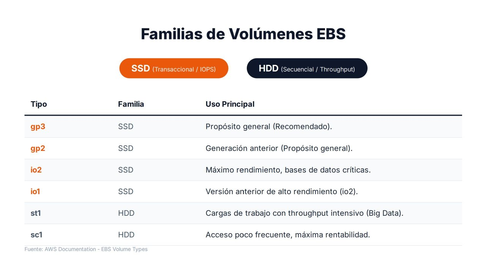

# Tipos de volúmenes EBS

Una de las decisiones más importantes al diseñar una infraestructura en AWS es elegir correctamente el **tipo de volumen**. No todos los discos están pensados para las mismas cargas de trabajo: si se elige un volumen con más rendimiento del necesario se incrementan los costes, y si se elige uno insuficiente se generan **cuellos de botella** que afectan a toda la aplicación.

---

## Dos familias: SSD y HDD

| Familia | Optimizada para | Métrica que importa | Tipos |
| --- | --- | --- | --- |
| **SSD** | Cargas **transaccionales**: operaciones pequeñas y aleatorias | **IOPS** y latencia | `gp3`, `gp2`, `io2`, `io1` |
| **HDD** | Grandes flujos de datos **secuenciales** | **Rendimiento** (MiB/s) y coste por GiB | `st1`, `sc1` |

!!! note "IOPS y rendimiento"
    - Las **IOPS** miden **cuántas** operaciones de lectura o escritura se realizan por segundo. Importan cuando la aplicación hace muchos accesos pequeños y dispersos, como una base de datos.
    - El **rendimiento** (*throughput*) mide **cuántos datos** se transfieren por segundo. Importa cuando se leen o escriben ficheros grandes de forma continua, como en analítica o en procesamiento de registros.

    Ambos están relacionados: rendimiento ≈ IOPS × tamaño de la operación. Un volumen puede tener muchas IOPS y poco rendimiento, o al revés.

---

## Volúmenes SSD

### gp3: propósito general (recomendado)

`gp3` es la **opción recomendada para la mayoría de los despliegues** y la que debería elegirse por defecto cuando no hay requisitos de rendimiento extremo.

Su principal ventaja es que permite configurar **de forma independiente** la capacidad, las IOPS y el rendimiento: ya no es necesario aumentar el tamaño del volumen solo para obtener más rendimiento.

- Todos los volúmenes incluyen un rendimiento base de **3.000 IOPS** y **125 MiB/s**, sea cual sea su tamaño.
- Se pueden aprovisionar IOPS y rendimiento adicionales, que se pagan aparte.
- Desde septiembre de 2025 admite hasta **64 TiB**, **80.000 IOPS** y **2.000 MiB/s** por volumen.

**Usos**: discos de arranque, servidores web y de aplicaciones, entornos virtualizados, contenedores, sistemas empresariales estándar y bases de datos pequeñas o medianas.

### gp2: propósito general de generación anterior

`gp2` fue durante años el estándar de AWS. Su diferencia fundamental es que **las IOPS dependen del tamaño**: **3 IOPS por GiB** (mínimo 100, máximo 16.000). Los volúmenes de menos de 1 TiB pueden realizar **ráfagas** de hasta 3.000 IOPS gastando créditos de E/S, cuyo saldo se observa en la métrica `BurstBalance`.

Esta dependencia obligaba con frecuencia a **sobredimensionar la capacidad** para alcanzar el rendimiento necesario. Por ejemplo, para obtener 6.000 IOPS sostenidas hacían falta 2.000 GiB, aunque solo se ocuparan 200.

!!! tip "Migrar de gp2 a gp3"
    `gp3` ofrece un rendimiento base igual o superior a casi cualquier `gp2` y su precio por GiB es aproximadamente un **20 % inferior**. El cambio de tipo se hace **en caliente**, sin desadjuntar el volumen ni detener la instancia (`aws ec2 modify-volume --volume-type gp3`). Es una de las optimizaciones de coste más sencillas en una cuenta con volúmenes antiguos.

### io2 Block Express: IOPS aprovisionadas

`io2` pertenece a la categoría de **alto rendimiento** y está diseñado para aplicaciones críticas que requieren **latencias muy bajas y un comportamiento predecible**. Su objetivo no es el equilibrio entre coste y prestaciones, sino **garantizar** niveles de rendimiento elevados de forma constante.

- Hasta **64 TiB**, **256.000 IOPS** y **4.000 MiB/s** por volumen, con hasta 1.000 IOPS por GiB.
- Durabilidad del **99,999 %**, frente al 99,8–99,9 % del resto de tipos.
- Admite **Multi-Attach** y **reservas NVMe**.

**Usos**: bases de datos corporativas de misión crítica (Oracle Database, Microsoft SQL Server, SAP HANA), sistemas financieros y cualquier aplicación en la que una degradación del rendimiento tenga impacto directo en el negocio.

### io1: IOPS aprovisionadas de generación anterior

`io1` fue el precursor de `io2` y comparte su filosofía: un número de IOPS garantizado y configurable (hasta 64.000 IOPS y 50 IOPS por GiB). Sigue siendo compatible, pero AWS recomienda `io2` para nuevas implementaciones por su mayor durabilidad y rendimiento a un precio similar. En los entornos actuales aparece sobre todo por compatibilidad con infraestructuras existentes.

---

## Volúmenes HDD

### st1: HDD optimizado para rendimiento

En `st1` lo importante no son las IOPS ni la latencia, sino la capacidad de **mover grandes cantidades de datos de forma continua**. Su rendimiento base crece con el tamaño (40 MiB/s por TiB) y puede alcanzar ráfagas de hasta **500 MiB/s**.

**Usos**: plataformas Big Data, clústeres Hadoop, procesos ETL, análisis masivo y procesamiento de registros. Si una aplicación lee varios terabytes de forma secuencial, `st1` resulta más eficiente y económico que un SSD.

### sc1: HDD de bajo coste

`sc1` es la opción **más económica** de EBS, pensada para datos de **acceso poco frecuente** en los que el objetivo es minimizar el gasto. Su rendimiento máximo es de **250 MiB/s**.

**Usos**: archivos históricos, registros antiguos, repositorios documentales o información que debe conservarse durante años y rara vez se consulta. No es adecuado para aplicaciones activas ni para bases de datos: se sacrifica velocidad para obtener el menor coste posible.

!!! warning "Limitaciones de los volúmenes HDD"
    - **No pueden ser volumen de arranque.**
    - Su tamaño mínimo es de **125 GiB**.
    - Rinden mal con operaciones pequeñas y aleatorias: una base de datos sobre `st1` o `sc1` sufrirá latencias muy elevadas.

---

## Resumen comparativo

| Tipo | Familia | Tamaño | IOPS máx. | Rendimiento máx. | Arranque | Multi-Attach | Uso principal |
| --- | --- | --- | --- | --- | --- | --- | --- |
| **gp3** | SSD | 1 GiB – 64 TiB | 80.000 (3.000 incluidas) | 2.000 MiB/s (125 incluidos) | Sí | No | **Propósito general (recomendado)** |
| **gp2** | SSD | 1 GiB – 16 TiB | 16.000 (3 por GiB) | 250 MiB/s | Sí | No | Propósito general (anterior) |
| **io2 Block Express** | SSD | 4 GiB – 64 TiB | 256.000 | 4.000 MiB/s | Sí | **Sí** | Bases de datos críticas |
| **io1** | SSD | 4 GiB – 16 TiB | 64.000 | 1.000 MiB/s | Sí | **Sí** | Alto rendimiento (anterior) |
| **st1** | HDD | 125 GiB – 16 TiB | 500 | 500 MiB/s | **No** | No | Big Data, ETL, registros |
| **sc1** | HDD | 125 GiB – 16 TiB | 250 | 250 MiB/s | **No** | No | Datos fríos, mínimo coste |

!!! note "Límites de la instancia"
    El rendimiento real está limitado también por la **instancia**: cada tipo de instancia tiene un máximo de IOPS y de ancho de banda hacia EBS. Un volumen `io2` de 100.000 IOPS adjuntado a una instancia pequeña no alcanzará ese valor. Al dimensionar hay que comprobar ambos límites.

---

## Cómo elegir el tipo de volumen

Como regla general:

- Para una **máquina virtual estándar**, se utiliza **`gp3`**.
- Para una **base de datos crítica** con requisitos estrictos de rendimiento y latencia, **`io2`**.
- Para **grandes volúmenes de datos secuenciales** orientados a analítica o Big Data, **`st1`**.
- Para **almacenamiento de bajo coste con acceso ocasional**, **`sc1`**.

| Escenario | Volumen | Justificación |
| --- | --- | --- |
| Servidor web Apache con WordPress | `gp3` 20 GiB | Rendimiento base suficiente y coste mínimo |
| Base de datos MySQL de una tienda online mediana | `gp3` con IOPS adicionales | Se ajustan las IOPS sin sobredimensionar el tamaño |
| SQL Server con miles de transacciones por segundo | `io2` | Latencia estable y rendimiento garantizado |
| Clúster de procesamiento de registros de 8 TiB | `st1` | Lectura secuencial masiva a bajo coste |
| Archivo de documentación legal de 10 años | `sc1` (o S3 Glacier) | Acceso muy ocasional; prima el coste |

La elección correcta no solo afecta al rendimiento de la aplicación, sino también al **coste operativo** de toda la infraestructura. Además, gracias a Elastic Volumes, el tipo puede **cambiarse más adelante** si la monitorización demuestra que la elección inicial no era la adecuada.

---

## Referencias

- AWS. *Amazon EBS volume types* — [Tipos de volúmenes](https://docs.aws.amazon.com/ebs/latest/userguide/ebs-volume-types.html)
- AWS. *General Purpose SSD volumes* — [Volúmenes gp2 y gp3](https://docs.aws.amazon.com/ebs/latest/userguide/general-purpose.html)
- AWS. *Provisioned IOPS SSD volumes* — [Volúmenes io1 e io2](https://docs.aws.amazon.com/ebs/latest/userguide/provisioned-iops.html)
- AWS. *Throughput Optimized HDD and Cold HDD volumes* — [Volúmenes st1 y sc1](https://docs.aws.amazon.com/ebs/latest/userguide/hdd-vols.html)
- AWS. *Amazon EBS increases the maximum size and provisioned performance of General Purpose (gp3) volumes* (09/2025) — [Anuncio](https://aws.amazon.com/es/about-aws/whats-new/2025/09/amazon-ebs-size-provisioned-performance-gp3-volumes/)
- AWS. *Amazon EBS-optimized instance types* — [Límites de la instancia](https://docs.aws.amazon.com/ec2/latest/instancetypes/ec2-instance-type-specifications.html)
