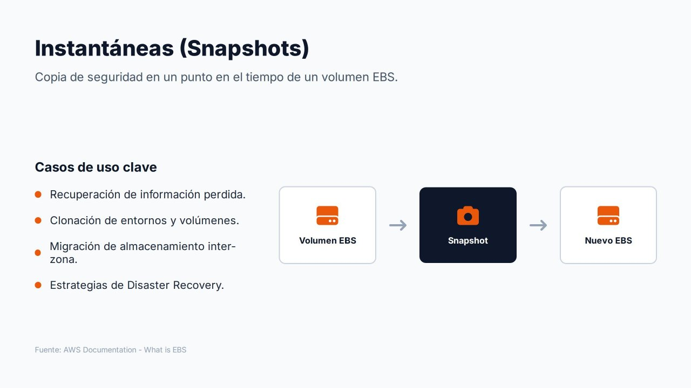
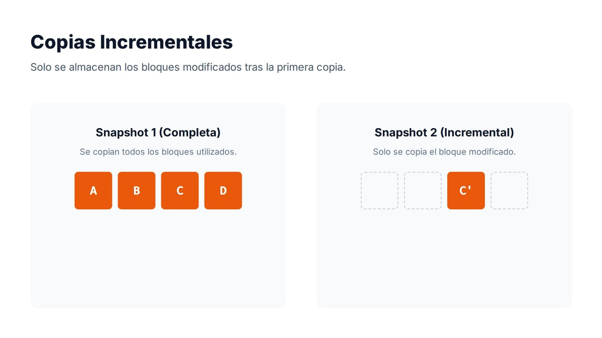
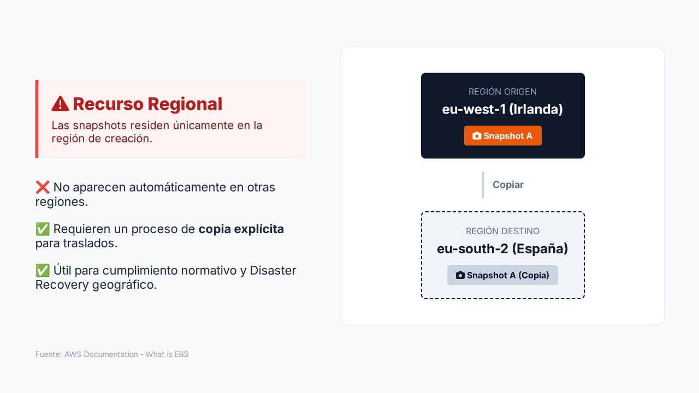

# Instantáneas de EBS



Las **instantáneas** (*snapshots*) son uno de los mecanismos más importantes de protección de datos en Amazon EBS. Una instantánea es una **copia de seguridad de un volumen en un momento concreto**: AWS captura el estado de sus bloques y permite reconstruir más adelante el volumen exactamente como se encontraba en ese instante.

Sin instantáneas se tendría almacenamiento persistente, pero no una forma eficaz de recuperar la información ante errores o desastres.

---

## Casos de uso

| Caso de uso | Descripción |
| --- | --- |
| **Recuperación de información** | Ante un borrado accidental, una corrupción de datos o una actualización fallida, se restaura un estado anterior conocido |
| **Clonación de entornos** | A partir de una instantánea se crean volúmenes idénticos al original para pruebas, laboratorios o preproducción |
| **Migración entre zonas de disponibilidad** | Un volumen solo existe en una AZ; con una instantánea se crea un volumen nuevo en otra AZ de la región |
| **Recuperación ante desastres** | Instantáneas periódicas, copiadas a otra región, permiten reconstruir servidores y aplicaciones tras un incidente grave |
| **Creación de AMI** | Una AMI respaldada por EBS está formada por instantáneas de sus volúmenes |
| **Cifrado de volúmenes existentes** | Copiando una instantánea con cifrado se obtienen volúmenes cifrados a partir de uno sin cifrar |

El proceso general es sencillo: se parte de un **volumen operativo**, se crea una **instantánea** que almacena su estado y, cuando es necesario, se utiliza para generar **uno o varios volúmenes nuevos**.

=== "Consola AWS"

    **Crear la instantánea**

    1. **EC2 → Elastic Block Store → Volúmenes** y seleccionar el volumen.
    2. **Acciones → Crear instantánea** (*Create snapshot*).
    3. Escribir una **descripción** («Datos web antes de actualizar») y añadir la etiqueta `Name = web-pre-update`.
    4. Pulsar **Crear instantánea**.
    5. En **EC2 → Elastic Block Store → Instantáneas**, esperar a que el **estado de la instantánea** pase de *Pendiente* a **Completada**. La columna **Progreso** muestra el avance.

    **Crear un volumen a partir de ella**

    1. En **Instantáneas**, seleccionar la instantánea.
    2. **Acciones → Crear volumen a partir de una instantánea** (*Create volume from snapshot*).
    3. Elegir el **tipo** (`gp3`), el **tamaño** (igual o mayor que el original) y la **zona de disponibilidad** de destino (`us-east-1b`).
    4. Pulsar **Crear volumen**.

=== "AWS CLI"

    ```bash
    # Crear una instantánea con descripción y etiquetas
    aws ec2 create-snapshot --volume-id vol-0123456789abcdef0 \
      --description "Datos web antes de actualizar" \
      --tag-specifications 'ResourceType=snapshot,Tags=[{Key=Name,Value=web-pre-update}]'

    # Esperar a que termine
    aws ec2 wait snapshot-completed --snapshot-ids snap-0abc...

    # Crear un volumen nuevo a partir de ella, en otra AZ
    aws ec2 create-volume --snapshot-id snap-0abc... \
      --availability-zone us-east-1b --volume-type gp3
    ```

---

## Copias incrementales



Las instantáneas de EBS son **incrementales**:

1. La **primera** instantánea copia todos los bloques **que contienen datos** (no los bloques vacíos).
2. Las **siguientes** solo almacenan los bloques **que han cambiado** desde la instantánea anterior.

En el ejemplo de la figura, la primera instantánea contiene los bloques A, B, C y D. Después se modifica únicamente el bloque C. La segunda instantánea no vuelve a almacenar A, B y D, porque siguen siendo idénticos: solo guarda la nueva versión C'.

**¿Cómo se restaura una instantánea completa si solo contiene los cambios?** AWS mantiene una estructura de **referencias** entre instantáneas. Aunque físicamente solo se almacenen los bloques modificados, **cada instantánea es autosuficiente** y puede utilizarse por sí sola para crear un volumen completo.

Este diseño aporta tres ventajas:

- Reduce considerablemente el **espacio** consumido y, por tanto, el coste.
- Reduce el **tiempo** necesario para crear cada instantánea.
- Permite realizar copias **frecuentes** sin que el coste crezca en proporción al tamaño del volumen.

!!! note "¿Qué ocurre al borrar una instantánea?"
    Al eliminar una instantánea, AWS solo borra los bloques que **no** son necesarios para ninguna otra. Se puede eliminar cualquier instantánea intermedia sin perder la capacidad de restaurar las demás. Por esa misma razón, borrar instantáneas antiguas no siempre libera tanto espacio como su tamaño aparente.

### Consistencia de la instantánea

Una instantánea captura los bloques **escritos en el volumen** en el instante de su creación. Los datos que la aplicación o el sistema operativo tienen todavía en memoria **no** se incluyen. Para obtener una copia coherente:

- En un volumen de datos, se puede **detener la escritura** de la aplicación o **desmontar** el volumen durante el inicio de la instantánea.
- En bases de datos, se utilizan los mecanismos del motor (vaciado de tablas, modo de copia de seguridad) o, mejor, las copias del propio servicio gestionado.
- Para instancias con **varios volúmenes**, se pueden crear instantáneas **coherentes entre sí** (*crash-consistent*) de todos los volúmenes en el mismo instante:

    === "Consola AWS"

        1. **EC2 → Elastic Block Store → Instantáneas → Crear instantánea**.
        2. En **Tipo de recurso**, elegir **Instancia** y seleccionar la instancia.
        3. Opcionalmente, **excluir el volumen raíz** y marcar **Copiar etiquetas del volumen de origen**.
        4. **Crear instantánea**: se genera una instantánea por volumen, todas del mismo instante.

    === "AWS CLI"

        ```bash
        aws ec2 create-snapshots \
          --instance-specification InstanceId=i-0123456789abcdef0 \
          --copy-tags-from-source volume
        ```

La instantánea comienza en un instante concreto y se completa de forma **asíncrona**: mientras su estado es `pending`, el volumen puede seguir utilizándose con normalidad.

---

## Recurso regional



Las instantáneas son **recursos regionales**: se almacenan de forma redundante en varias zonas de disponibilidad de la región (en un almacenamiento gestionado por AWS sobre Amazon S3, que no aparece entre los *buckets* del cliente) y **solo están disponibles en la región en la que se crearon**.

Por ejemplo, una instantánea creada en Irlanda (`eu-west-1`) no aparece automáticamente en España (`eu-south-2`). Para usarla en otra región hay que realizar una **copia explícita**, que crea una instantánea **nueva e independiente** en el destino:

=== "Consola AWS"

    1. En la región de **origen** (`eu-west-1`), ir a **EC2 → Elastic Block Store → Instantáneas** y seleccionar la instantánea.
    2. **Acciones → Copiar instantánea** (*Copy snapshot*).
    3. Indicar una **descripción** y la **Región de destino** (`eu-south-2`).
    4. Marcar **Cifrar esta instantánea** y elegir la **clave de KMS** de la región de destino.
    5. Pulsar **Copiar instantánea**.
    6. Cambiar a la región de **destino** en el selector de regiones: la copia aparece en **Instantáneas** con estado *Pendiente* hasta completarse.

=== "AWS CLI"

    ```bash
    # Se ejecuta en la región de DESTINO
    aws ec2 copy-snapshot \
      --region eu-south-2 \
      --source-region eu-west-1 \
      --source-snapshot-id snap-0abc... \
      --description "Copia DR desde Irlanda" \
      --encrypted --kms-key-id alias/clave-dr
    ```

Este comportamiento no es un inconveniente, sino una decisión de diseño:

- **Cumplimiento normativo**: muchas organizaciones deben garantizar que ciertos datos permanecen en una ubicación geográfica concreta. Que las instantáneas no salgan de la región sin una acción explícita facilita ese control.
- **Recuperación ante desastres**: copiar instantáneas a una segunda región, a cientos o miles de kilómetros, evita que un único incidente regional comprometa la continuidad del negocio.

!!! warning "Alta disponibilidad no es recuperación ante desastres"
    La replicación interna de EBS protege frente a fallos **dentro de una zona de disponibilidad**. Las instantáneas regionales protegen frente a la pérdida de **una zona**. Solo las **copias a otra región** protegen frente a incidentes que afecten a **toda la región**. En arquitecturas empresariales es habitual definir una región principal para producción y una o varias secundarias donde se guardan copias para la continuidad operativa.

---

## Funcionalidades avanzadas de las instantáneas

| Funcionalidad | Para qué sirve | Consideraciones |
| --- | --- | --- |
| **Nivel de archivo** (*EBS Snapshots Archive*) | Guardar instantáneas que se conservan mucho tiempo y casi nunca se restauran (normativa, cierres anuales) | Almacenamiento hasta un **75 % más barato**; permanencia mínima de **90 días**; restaurar tarda entre **24 y 72 horas** y tiene coste |
| **Papelera de reciclaje** (*Recycle Bin*) | Recuperar instantáneas y AMI **borradas por error** | Se definen reglas de retención (por ejemplo, conservar 7 días lo borrado) |
| **Bloqueo de instantáneas** (*Snapshot Lock*) | Impedir que nadie, ni siquiera un administrador, borre una instantánea durante un periodo | Modo *governance* (los usuarios con permiso pueden desbloquear) o *compliance* (inmutable); protege frente a *ransomware* |
| **Restauración rápida** (*Fast Snapshot Restore*) | Que los volúmenes creados desde una instantánea ofrezcan **todo su rendimiento desde el primer momento** | Se activa por instantánea y AZ y tiene coste por hora |
| **Compartir instantáneas** | Usar una instantánea en otra cuenta de AWS | Las cifradas con la clave **administrada por AWS** no se pueden compartir; hace falta una clave del cliente |
| **Bloqueo del acceso público** | Impedir a nivel de región que las instantáneas se compartan públicamente | Muy recomendable: una instantánea pública expone todo el disco |

!!! note "Inicialización de volúmenes restaurados"
    Un volumen creado desde una instantánea está disponible de inmediato, pero sus bloques se descargan del almacenamiento de instantáneas **la primera vez que se leen**. Ese primer acceso tiene más latencia. Si se necesita el rendimiento completo desde el principio (por ejemplo, al restaurar una base de datos de producción), se activa *Fast Snapshot Restore* o se leen previamente todos los bloques con herramientas como `fio` o `dd`.

---

## Automatización de las instantáneas

Crear instantáneas a mano no es una estrategia de copia de seguridad. En producción se programan con:

- **Amazon Data Lifecycle Manager (DLM)**: políticas que seleccionan volúmenes o instancias **por etiquetas**, definen la **frecuencia** (por ejemplo, cada 12 horas), la **retención** (por número o por antigüedad), la **copia a otra región** y el paso al **nivel de archivo**.
- **AWS Backup**: servicio centralizado que gestiona copias de EBS, EFS, RDS, DynamoDB y otros servicios con **planes de copia** comunes.

Ambos se estudian en el apartado de **copias de seguridad y recuperación**. Como las instantáneas son incrementales, es habitual programarlas **varias veces al día** en entornos productivos: cuanto más frecuentes, menor es la cantidad de información que podría perderse entre el último respaldo y un fallo.

---

## Referencias

- AWS. *Amazon EBS snapshots* — [Instantáneas de EBS](https://docs.aws.amazon.com/ebs/latest/userguide/ebs-snapshots.html)
- AWS. *How Amazon EBS snapshots work* — [Funcionamiento incremental](https://docs.aws.amazon.com/ebs/latest/userguide/how_snapshots_work.html)
- AWS. *Copy an Amazon EBS snapshot* — [Copia de instantáneas](https://docs.aws.amazon.com/ebs/latest/userguide/ebs-copy-snapshot.html)
- AWS. *Archive Amazon EBS snapshots* — [Nivel de archivo](https://docs.aws.amazon.com/ebs/latest/userguide/snapshot-archive.html)
- AWS. *Recycle Bin* — [Papelera de reciclaje](https://docs.aws.amazon.com/ebs/latest/userguide/recycle-bin.html)
- AWS. *Lock Amazon EBS snapshots* — [Bloqueo de instantáneas](https://docs.aws.amazon.com/ebs/latest/userguide/ebs-snapshot-lock.html)
- AWS. *Amazon EBS fast snapshot restore* — [Restauración rápida](https://docs.aws.amazon.com/ebs/latest/userguide/ebs-fast-snapshot-restore.html)
- AWS. *Block public access for snapshots* — [Bloqueo del acceso público](https://docs.aws.amazon.com/ebs/latest/userguide/block-public-access-snapshots.html)
