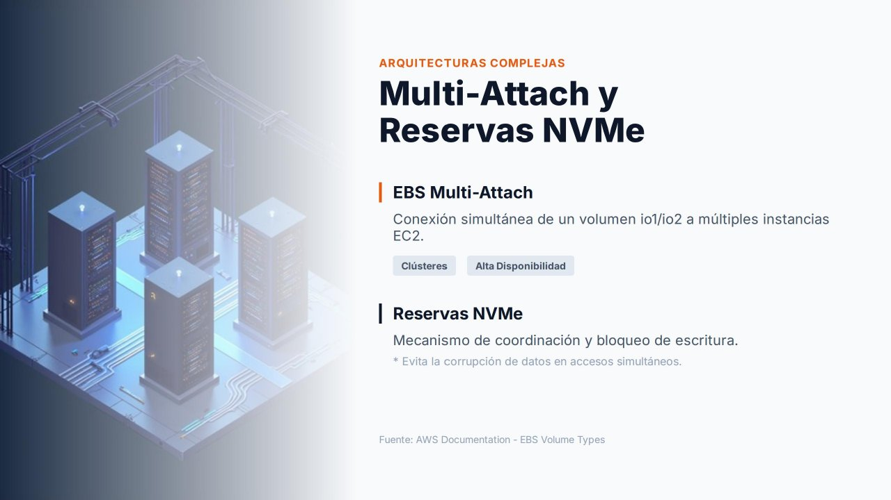

# Multi-Attach y reservas NVMe

!!! info "Contenido de ampliación"
    Esta página es **opcional**. Desarrolla contenidos que en el núcleo de la unidad solo se mencionan. No es necesaria para realizar las prácticas.

En condiciones normales, un volumen EBS se conecta a **una única instancia EC2**. Este modelo simplifica la gestión y evita los problemas derivados del acceso concurrente a los datos. Sin embargo, existen escenarios empresariales en los que **varios servidores necesitan acceder simultáneamente al mismo almacenamiento en bloques**. Para ellos, AWS ofrece **EBS Multi-Attach** y, como mecanismo de coordinación, las **reservas NVMe**.

---

## EBS Multi-Attach

Multi-Attach permite adjuntar **un mismo volumen** a **varias instancias** a la vez. Cada instancia tiene permisos completos de lectura y escritura sobre el volumen compartido.

### Requisitos y limitaciones

| Aspecto | Detalle |
| --- | --- |
| **Tipos de volumen** | Solo **`io1`** e **`io2`** (IOPS aprovisionadas) |
| **Ubicación** | Todas las instancias en la **misma zona de disponibilidad** que el volumen |
| **Número de instancias** | Hasta **16** instancias basadas en **Nitro** |
| **Volumen de arranque** | **No** puede utilizarse como volumen raíz |
| **Activación** | Al crear el volumen (`--multi-attach-enabled`) o posteriormente con el volumen desadjuntado |
| **Métricas** | Algunas métricas de CloudWatch no están disponibles para volúmenes Multi-Attach |

### Casos de uso

Multi-Attach se encuentra en arquitecturas en las que dos o más servidores colaboran para prestar un mismo servicio:

- **Clústeres de alta disponibilidad**: si uno de los nodos falla, los demás siguen accediendo a los mismos datos sin migraciones ni cambios de almacenamiento.
- **Clústeres de conmutación por error de Windows Server** (WSFC) y bases de datos en clúster.
- **Aplicaciones distribuidas** que gestionan por sí mismas la coherencia de las escrituras.

---

## El problema del acceso concurrente

Compartir un volumen entre varias instancias introduce un problema evidente: si dos servidores escriben al mismo tiempo sobre los mismos bloques, se producen **inconsistencias** o incluso la **corrupción** de la información.

!!! danger "Multi-Attach no convierte EBS en un sistema de ficheros compartido"
    El volumen sigue siendo un **dispositivo de bloques**. Los sistemas de ficheros habituales, como **`xfs`** o **`ext4`**, suponen que **solo un sistema operativo** escribe en el disco: cada instancia mantiene su propia caché y sus propios metadatos, y dos instancias montando el mismo `xfs` en lectura/escritura **corromperán** el sistema de ficheros.

    Para compartir un volumen Multi-Attach hace falta un **sistema de ficheros de clúster** (como GFS2 u OCFS2) o una aplicación que coordine el acceso. Si lo que se necesita es simplemente que varios servidores compartan ficheros, la solución adecuada es **Amazon EFS**.

---

## Reservas NVMe

Las **reservas NVMe** (*NVMe reservations*) son el mecanismo estándar del protocolo NVMe para **coordinar y bloquear** el acceso a un dispositivo compartido. Permiten que el software de clúster decida **qué instancia puede escribir** en el volumen en cada momento y **excluir** a un nodo que ha dejado de responder (*fencing*), evitando que siga escribiendo y corrompa los datos.

Funcionan de forma similar a los **bloqueos** de las bases de datos o de los sistemas de ficheros distribuidos: garantizan que las operaciones concurrentes se realicen de forma ordenada y segura.

| Aspecto | Detalle |
| --- | --- |
| **Volúmenes** | `io2` con Multi-Attach habilitado |
| **Quién las utiliza** | El software de clúster: Windows Server Failover Clustering, Pacemaker, Oracle RAC, etc. |
| **Función** | Registrar los nodos, reservar el acceso de escritura, liberar o retirar la reserva de un nodo caído |

Es importante entender que la coordinación de los accesos sigue siendo **responsabilidad del sistema operativo, del software de clúster o de la aplicación**. AWS proporciona el mecanismo, pero no lo utiliza por sí mismo.

---

## Resumen

| Funcionalidad | Qué aporta |
| --- | --- |
| **Multi-Attach** | Compartir **un volumen de bloques** entre varias instancias de la misma AZ |
| **Reservas NVMe** | El **mecanismo de bloqueo** que evita conflictos y mantiene la integridad de los datos |
| **Amazon EFS** | La alternativa cuando lo que se necesita es **compartir ficheros**, incluso entre varias AZ |

---

## Referencias

- AWS. *Attach a volume to multiple instances with Amazon EBS Multi-Attach* — [Multi-Attach](https://docs.aws.amazon.com/ebs/latest/userguide/ebs-volumes-multi.html)
- AWS. *NVMe reservations* — [Reservas NVMe](https://docs.aws.amazon.com/ebs/latest/userguide/nvme-reservations.html)
- AWS Storage Blog. *Clustered storage simplified: GFS2 on Amazon EBS Multi-Attach enabled volumes* — [Artículo](https://aws.amazon.com/blogs/storage/clustered-storage-simplified-gfs2-on-amazon-ebs-multi-attach-enabled-volumes/)
