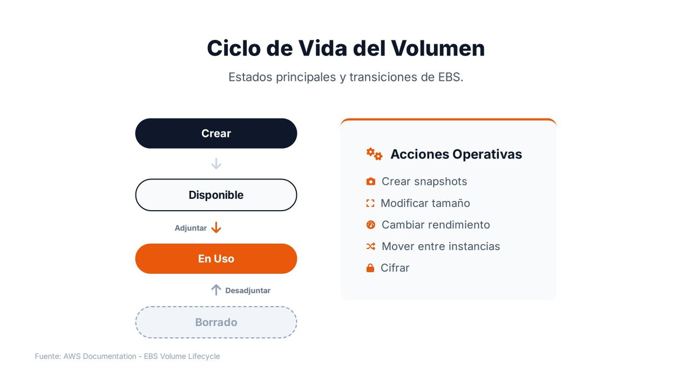
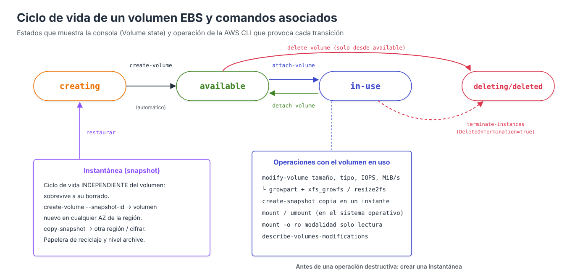

# Ciclo de vida de un volumen: crear, montar, modificar y eliminar



Como cualquier recurso de infraestructura, un volumen EBS pasa por distintos **estados** a lo largo de su existencia. Comprender este ciclo de vida y las operaciones que provocan cada transición es fundamental para administrar el almacenamiento, optimizar costes y garantizar que los datos permanezcan protegidos.

Este apartado recorre el ciclo completo de un **volumen de datos**, combinando las operaciones de AWS (consola o AWS CLI) con las que hay que realizar **dentro del sistema operativo**, que es donde se crea el sistema de ficheros y donde se monta.

---

## Estados de un volumen



| Estado | Significado |
| --- | --- |
| `creating` | AWS está aprovisionando el volumen en la AZ seleccionada |
| `available` | El volumen existe pero **no está adjuntado** a ninguna instancia. Se paga igualmente |
| `in-use` | El volumen está adjuntado a una instancia y el sistema operativo puede utilizarlo |
| `deleting` / `deleted` | El volumen se está eliminando o ya se ha eliminado. Sin una instantánea previa, los datos se pierden **de forma permanente** |
| `error` | Fallo en el hardware subyacente; los datos deben recuperarse de una instantánea |

Además del estado del volumen, cada **adjunto** tiene su propio estado (`attaching`, `attached`, `detaching`, `detached`) y cada **modificación** el suyo (`modifying`, `optimizing`, `completed`).

!!! tip "Volúmenes huérfanos"
    Un volumen en estado `available` no está prestando servicio, pero **sigue facturándose** por su tamaño aprovisionado. Es frecuente que queden volúmenes huérfanos tras terminar instancias cuyos volúmenes de datos tenían *DeleteOnTermination* desactivado. Revisarlos periódicamente es una optimización de coste sencilla:

    === "Consola AWS"

        En **EC2 → Elastic Block Store → Volúmenes**, añadir el filtro **Estado del volumen = Disponible** (*Volume state = Available*). La lista muestra el tamaño, el tipo y la fecha de creación de cada volumen sin asociar.

    === "AWS CLI"

        ```bash
        aws ec2 describe-volumes --filters Name=status,Values=available \
          --query "Volumes[].[VolumeId,Size,VolumeType,CreateTime]" --output table
        ```

---

## 1. Crear el volumen

Las decisiones que hay que tomar al crear un volumen son:

| Opción | Recomendación |
| --- | --- |
| **Tipo de volumen** | `gp3` salvo requisitos específicos |
| **Tamaño** | El necesario hoy más un margen razonable; se puede ampliar después, **pero no reducir** |
| **IOPS y rendimiento** | Los valores base de `gp3` (3.000 IOPS, 125 MiB/s) salvo que la carga exija más |
| **Zona de disponibilidad** | **La misma que la instancia** a la que se va a adjuntar |
| **Instantánea** | Vacío para un volumen nuevo, o un ID para restaurar datos |
| **Cifrado** | Activado, con la clave por defecto o con una clave propia |
| **Etiquetas** | `Name`, `entorno`, `proyecto`… Permiten identificar costes y aplicar políticas de copia |

=== "Consola AWS"

    1. Averiguar la AZ de la instancia: **EC2 → Instancias**, seleccionar la instancia; en la pestaña **Redes** figura la **Zona de disponibilidad** (`us-east-1a`).
    2. **EC2 → Elastic Block Store → Volúmenes → Crear volumen**.
    3. **Tipo de volumen**: SSD de uso general (`gp3`). **Tamaño**: `10` GiB. **IOPS** `3000` y **Rendimiento** `125` (valores base).
    4. **Zona de disponibilidad**: `us-east-1a`, la misma que la instancia.
    5. **ID de instantánea**: dejar sin instantánea para un volumen vacío.
    6. Marcar **Cifrar este volumen** y elegir la clave de KMS (por defecto, `aws/ebs`).
    7. **Etiquetas**: `Name = datos-web` y `backup = diario`.
    8. Pulsar **Crear volumen**. El estado pasa de *Creando* a **Disponible**.

=== "AWS CLI"

    ```bash
    # Averiguar la AZ de la instancia
    aws ec2 describe-instances --instance-ids i-0123456789abcdef0 \
      --query "Reservations[0].Instances[0].Placement.AvailabilityZone" --output text

    aws ec2 create-volume \
      --availability-zone us-east-1a \
      --size 10 --volume-type gp3 \
      --encrypted \
      --tag-specifications 'ResourceType=volume,Tags=[{Key=Name,Value=datos-web},{Key=backup,Value=diario}]'

    aws ec2 wait volume-available --volume-ids vol-0abc...
    ```

---

## 2. Adjuntar el volumen a la instancia

=== "Consola AWS"

    1. **EC2 → Elastic Block Store → Volúmenes**, seleccionar el volumen (estado *Disponible*).
    2. **Acciones → Asociar volumen** (*Attach volume*).
    3. **Instancia**: elegir la instancia. Solo aparecen las de la **misma zona de disponibilidad**.
    4. **Nombre del dispositivo**: `/dev/sdf` (la consola propone uno libre).
    5. Pulsar **Asociar volumen**. El estado del volumen pasa a **En uso**.

=== "AWS CLI"

    ```bash
    aws ec2 attach-volume --volume-id vol-0abc... \
      --instance-id i-0123456789abcdef0 --device /dev/sdf
    ```

En las instancias **Nitro** (la inmensa mayoría de las actuales), el sistema operativo no ve `/dev/sdf`, sino un dispositivo **NVMe**. Para identificarlo se utiliza `lsblk`; el número de serie del dispositivo coincide con el ID del volumen:

```bash
lsblk -o NAME,SIZE,TYPE,MOUNTPOINT,SERIAL
# NAME          SIZE TYPE MOUNTPOINT SERIAL
# nvme0n1         8G disk            vol0123456789abcdef0
# ├─nvme0n1p1     8G part /
# nvme1n1        10G disk            vol0abc...            <- el nuevo volumen
```

---

## 3. Crear el sistema de ficheros

Un volumen **nuevo** está vacío: no tiene sistema de ficheros. Antes de formatear hay que **asegurarse** de que efectivamente está vacío, porque formatear un volumen restaurado desde una instantánea **destruiría sus datos**:

```bash
sudo file -s /dev/nvme1n1
# /dev/nvme1n1: data                      -> vacío: se puede formatear
# /dev/nvme1n1: SGI XFS filesystem data   -> ya tiene datos: NO formatear

sudo mkfs -t xfs /dev/nvme1n1
```

---

## 4. Montar el volumen

### Montaje manual

```bash
sudo mkdir -p /datos
sudo mount /dev/nvme1n1 /datos
df -hT /datos
```

### Montaje permanente con `/etc/fstab`

El montaje manual se pierde al reiniciar. Para que sea permanente se añade una línea a `/etc/fstab`. Es importante utilizar el **UUID** del sistema de ficheros y no el nombre del dispositivo, porque en NVMe el orden de los nombres **puede cambiar** entre arranques:

```bash
sudo blkid /dev/nvme1n1
# /dev/nvme1n1: UUID="aaaa-bbbb-..." TYPE="xfs"

echo 'UUID=aaaa-bbbb-...  /datos  xfs  defaults,nofail  0  2' | sudo tee -a /etc/fstab

# Comprobar SIN reiniciar: si hay un error, mount -a lo mostrará
sudo umount /datos
sudo mount -a
findmnt /datos
```

| Opción | Función |
| --- | --- |
| `defaults` | Opciones estándar: lectura/escritura, montaje automático… |
| `nofail` | Si el volumen no está adjuntado, la instancia **arranca igualmente**. Sin ella, un volumen ausente puede impedir el arranque |
| `0` (quinto campo) | No se incluye en las copias de `dump` |
| `2` (sexto campo) | Orden de comprobación con `fsck` (1 para el raíz, 2 para el resto) |

!!! danger "Un error en `/etc/fstab` puede dejar la instancia sin arrancar"
    Comprobar siempre con `sudo mount -a` antes de reiniciar. Si la instancia no arranca, la recuperación consiste en detenerla, desadjuntar su volumen raíz, adjuntarlo a otra instancia, corregir el fichero y volver a adjuntarlo: un ejemplo práctico de la utilidad de desadjuntar volúmenes.

### Modalidad de acceso: solo lectura o lectura/escritura

Por defecto el volumen se monta en **lectura/escritura**. Para garantizar que una instancia **solo pueda leer** (por ejemplo, un volumen con datos de referencia restaurado desde una instantánea), se monta con la opción `ro`:

```bash
sudo mount -o ro /dev/nvme1n1 /datos            # montaje manual en solo lectura
sudo mount -o remount,ro /datos                 # pasar a solo lectura un montaje existente
# En /etc/fstab:
# UUID=aaaa-bbbb-...  /datos  xfs  ro,nofail  0  2
```

Dentro del sistema de ficheros, el acceso de cada usuario se controla con los **permisos POSIX** habituales (`chown`, `chmod`):

```bash
sudo chown -R apache:apache /datos/web
sudo chmod 750 /datos/web
```

!!! note "Origen del acceso"
    Un volumen EBS solo es accesible desde **la instancia a la que está adjuntado**: no tiene dirección de red ni grupo de seguridad. Controlar *desde dónde* se accede a los datos significa controlar **quién puede adjuntar el volumen** (permisos de IAM sobre `ec2:AttachVolume`) y **quién puede acceder a la instancia**.

---

## 5. Modificar el volumen (*Elastic Volumes*)

Mientras el volumen está en uso se puede:

- **Aumentar el tamaño** (nunca reducirlo).
- **Cambiar el tipo** (por ejemplo, de `gp2` a `gp3`, o de `gp3` a `io2`).
- **Ajustar las IOPS y el rendimiento** aprovisionados.

=== "Consola AWS"

    1. **EC2 → Elastic Block Store → Volúmenes**, seleccionar el volumen.
    2. **Acciones → Modificar volumen** (*Modify volume*).
    3. Cambiar el **Tipo de volumen**, el **Tamaño**, las **IOPS** o el **Rendimiento**. La consola muestra los valores actuales junto a los nuevos.
    4. Pulsar **Modificar** y confirmar.
    5. Seguimiento: la columna **Estado del volumen** muestra *En uso – modificando* y después *En uso – optimizando (n %)* hasta completarse.

=== "AWS CLI"

    ```bash
    aws ec2 modify-volume --volume-id vol-0abc... --size 20
    aws ec2 modify-volume --volume-id vol-0abc... --volume-type gp3 --iops 6000 --throughput 250

    # Seguimiento de la modificación
    aws ec2 describe-volumes-modifications --volume-ids vol-0abc... \
      --query "VolumesModifications[0].[ModificationState,Progress,TargetSize]"
    ```

La modificación pasa por los estados `modifying` → `optimizing` → `completed`. **En cuanto entra en `optimizing`, el nuevo tamaño ya puede utilizarse**, aunque el rendimiento puede variar hasta que termine la optimización.

| Restricción | Detalle |
| --- | --- |
| **No se puede reducir** | Para disminuir el tamaño hay que crear un volumen más pequeño y copiar los datos |
| **Frecuencia** | Desde enero de 2026, hasta **4 modificaciones** por volumen en una ventana móvil de **24 horas**, siempre que la anterior haya terminado (antes había que esperar 6 horas entre modificaciones) |
| **Límites del tipo** | `st1` y `sc1` requieren al menos 125 GiB; las IOPS máximas dependen del tamaño |

### Ampliar el sistema de ficheros

**Ampliar el volumen no amplía el sistema de ficheros.** AWS cambia el tamaño del dispositivo de bloques, pero el sistema operativo sigue utilizando el espacio anterior hasta que se extiende la partición (si la hay) y el sistema de ficheros:

```bash
lsblk                                   # el disco ya muestra el nuevo tamaño
df -h /datos                            # el sistema de ficheros, todavía el antiguo

# Volumen SIN particiones (el caso del volumen de datos creado arriba)
sudo xfs_growfs -d /datos               # xfs: se indica el punto de montaje
sudo resize2fs /dev/nvme1n1             # ext4: se indica el dispositivo

# Volumen CON particiones (por ejemplo, el volumen raíz)
sudo growpart /dev/nvme0n1 1            # extiende la partición 1
sudo xfs_growfs -d /                    # extiende el sistema de ficheros

df -h /datos                            # ya muestra el nuevo tamaño
```

Toda la operación se realiza **en caliente**, sin desmontar el volumen ni detener la instancia.

!!! tip "Buena práctica"
    Antes de una modificación importante, crear una **instantánea**. Aunque Elastic Volumes no borra datos, un error al extender la partición o el sistema de ficheros sí podría dañarlos.

---

## 6. Desmontar y desadjuntar

Para retirar un volumen de una instancia, primero se **desmonta en el sistema operativo** y después se **desadjunta en AWS**.

En la instancia:

```bash
sudo umount /datos
# Si devuelve "target is busy", averiguar qué proceso lo usa:
sudo lsof +f -- /datos
# Y eliminar o comentar su línea en /etc/fstab
```

En AWS:

=== "Consola AWS"

    1. **EC2 → Elastic Block Store → Volúmenes**, seleccionar el volumen (estado *En uso*).
    2. **Acciones → Desasociar volumen** (*Detach volume*) y confirmar.
    3. El estado pasa a **Disponible**.

    Solo si el sistema operativo no responde se utiliza **Forzar la desasociación**, con riesgo de pérdida de datos.

=== "AWS CLI"

    ```bash
    aws ec2 detach-volume --volume-id vol-0abc...
    aws ec2 wait volume-available --volume-ids vol-0abc...
    ```

!!! warning "No desadjuntar sin desmontar"
    Desadjuntar un volumen montado equivale a desenchufar un disco en uso: los datos en caché pueden perderse y el sistema de ficheros quedar inconsistente. El volumen **raíz** no puede desadjuntarse con la instancia en marcha: hay que detenerla antes.

El volumen vuelve al estado `available` y puede adjuntarse a otra instancia **de la misma AZ**.

---

## 7. Eliminar el volumen

=== "Consola AWS"

    1. **EC2 → Elastic Block Store → Volúmenes**, seleccionar el volumen (estado *Disponible*).
    2. **Acciones → Crear instantánea** con la descripción «Final antes de borrar», por si los datos se necesitan en el futuro.
    3. **Acciones → Eliminar volumen** (*Delete volume*) y confirmar.

=== "AWS CLI"

    ```bash
    # Instantánea final, por si los datos se necesitan en el futuro
    aws ec2 create-snapshot --volume-id vol-0abc... --description "Final antes de borrar"

    aws ec2 delete-volume --volume-id vol-0abc...
    ```

Solo pueden eliminarse volúmenes en estado `available`. Las instantáneas tienen un **ciclo de vida independiente**: pueden conservarse durante meses o años después de borrar el volumen y utilizarse en cualquier momento para recuperarlo.

### Eliminación al terminar la instancia

| Volumen | *DeleteOnTermination* por defecto |
| --- | --- |
| Raíz creado al lanzar la instancia | `true`: se borra al terminarla |
| Volúmenes adicionales en el lanzamiento | `true` en la consola, configurable |
| Volúmenes adjuntados después | `false`: **sobreviven** a la instancia |

El atributo puede cambiarse, por ejemplo para **proteger el volumen raíz** de un servidor importante:

=== "Consola AWS"

    - **Al lanzar la instancia**: en **Configurar almacenamiento → Avanzado**, desplegar cada volumen y establecer **Eliminar al terminar** en *No*.
    - **En una instancia existente**: la pestaña **Almacenamiento** de la instancia muestra el valor de **Eliminar al terminar** de cada volumen, pero la consola **no permite cambiarlo**. Para ello hay que usar la AWS CLI (o la API).

=== "AWS CLI"

    ```bash
    aws ec2 modify-instance-attribute --instance-id i-0123456789abcdef0 \
      --block-device-mappings '[{"DeviceName":"/dev/xvda","Ebs":{"DeleteOnTermination":false}}]'
    ```

---

## Referencias

- AWS. *Amazon EBS volume lifecycle* — [Ciclo de vida del volumen](https://docs.aws.amazon.com/ebs/latest/userguide/ebs-volume-lifecycle.html)
- AWS. *Make an Amazon EBS volume available for use* — [Formatear y montar](https://docs.aws.amazon.com/ebs/latest/userguide/ebs-using-volumes.html)
- AWS. *Modify a volume using Amazon EBS Elastic Volumes* — [Elastic Volumes](https://docs.aws.amazon.com/ebs/latest/userguide/ebs-modify-volume.html)
- AWS. *Extend the file system after resizing an Amazon EBS volume* — [Ampliar el sistema de ficheros](https://docs.aws.amazon.com/ebs/latest/userguide/recognize-expanded-volume-linux.html)
- AWS. *Detach an Amazon EBS volume from an instance* — [Desadjuntar](https://docs.aws.amazon.com/ebs/latest/userguide/ebs-detaching-volume.html)
- Classmethod. *EBS Elastic Volumes: the 6-hour wait time is gone, up to 4 modifications within 24 hours* (01/2026) — [Artículo](https://dev.classmethod.jp/en/articles/ebs-elastic-volumes-4-modifications/)
