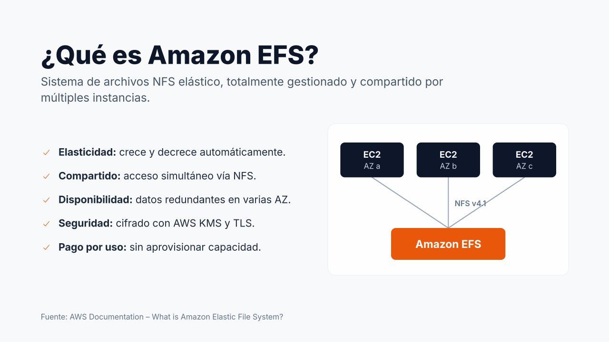
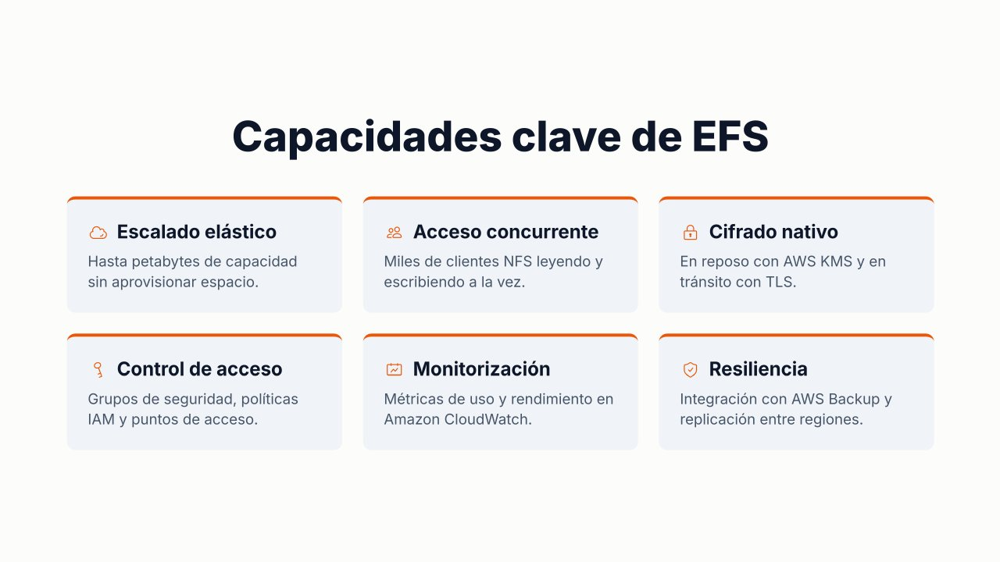
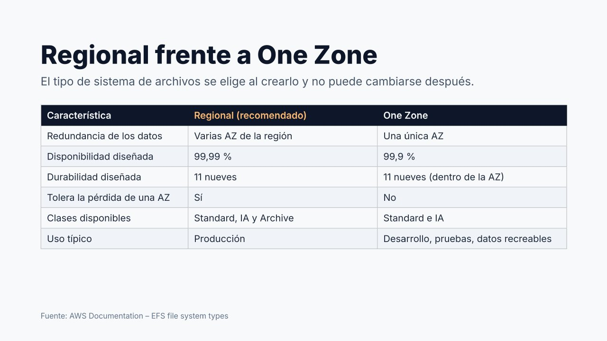
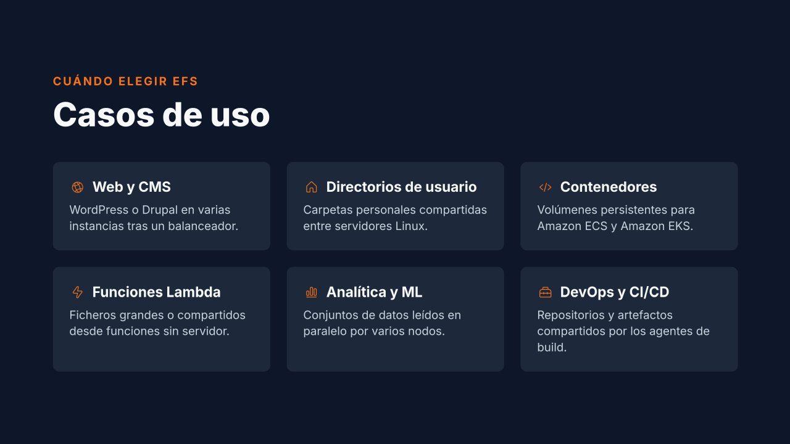

# Amazon EFS: visión general, tipos y casos de uso

Un volumen EBS es un disco para **una** instancia. Pero en muchas arquitecturas **varios servidores necesitan trabajar a la vez sobre los mismos ficheros**: un sitio web en varias instancias detrás de un balanceador, o un equipo que comparte un repositorio. Para eso existe **Amazon Elastic File System (EFS)**: un sistema de archivos **compartido**, **elástico** y **totalmente gestionado**, accesible mediante **NFS v4.0 / v4.1**. Es el equivalente en la nube a un servidor de ficheros o una cabina NAS, sin servidor que instalar ni mantener.

---

## Características

| Característica | Descripción |
| --- | --- |
| **Elasticidad** | No se indica un tamaño: crece al escribir y decrece al borrar. Se paga **solo lo ocupado** |
| **Acceso compartido** | Miles de clientes, incluso de **zonas distintas**, montan el mismo sistema y ven los mismos datos |
| **Disponibilidad** | En el tipo Regional, los datos se guardan en **varias zonas de disponibilidad** |
| **Cifrado** | En reposo con KMS (**se decide al crear y no se puede cambiar**) y en tránsito con TLS (se activa al montar) |
| **Control de acceso** | Grupos de seguridad, política del sistema de archivos (IAM), puntos de acceso y permisos POSIX |
| **Copias** | Integración con AWS Backup y replicación a otra región |
| **Clientes** | Linux. Para Windows (SMB) existe Amazon FSx for Windows File Server |

| Concepto | Descripción |
| --- | --- |
| **Sistema de archivos** | El recurso principal (`fs-0123456789abcdef0`). Es **regional** |
| **Destino de montaje** (*mount target*) | Interfaz de red con IP privada en una subred, por la que los clientes de esa AZ acceden al sistema |
| **Punto de acceso** (*access point*) | Entrada específica para una aplicación, con directorio raíz e identidad propios (`fsap-...`) |
| **Política del sistema de archivos** | Política de IAM asociada al sistema de archivos: quién puede montar, escribir o actuar como *root* |
| **`amazon-efs-utils`** | Paquete con el asistente de montaje (`mount -t efs`), que añade TLS e IAM |

!!! warning "Destino de montaje ≠ punto de acceso"
    Son dos cosas distintas que se confunden con facilidad. El **destino de montaje** es la **conexión de red** (lleva el grupo de seguridad). El **punto de acceso** es una **vista** del sistema de archivos para una aplicación (directorio y usuario).

---

## Tipos: Regional y One Zone

El tipo se elige **al crear** el sistema de archivos y **no puede cambiarse después**.

| | **Regional** (recomendado) | **One Zone** |
| --- | --- | --- |
| Datos guardados en | Varias AZ de la región | Una sola AZ |
| Disponibilidad diseñada | 99,99 % | 99,9 % |
| ¿Sobrevive a la caída de una AZ? | **Sí** | **No** |
| Clases de almacenamiento | Standard, IA y **Archive** | Standard e IA |
| Coste | Mayor | Aproximadamente la **mitad** |
| Uso típico | **Producción** | Desarrollo, pruebas, datos que se pueden regenerar |

Ni siquiera un sistema Regional protege frente a la pérdida de **toda una región**: para eso hace falta replicación o copias en otra región.

---

## Casos de uso

El patrón común es siempre el mismo: **varios clientes necesitan los mismos ficheros a la vez**.

- **Servidores web y CMS**: varias instancias de WordPress detrás de un balanceador comparten las imágenes subidas.
- **Directorios de usuario**: los `/home` se montan en varios servidores Linux.
- **Contenedores** (ECS, EKS) y **funciones Lambda** que necesitan almacenamiento persistente compartido.
- **Analítica, aprendizaje automático y CI/CD**: varios nodos leen los mismos datos o comparten artefactos.

**Cuándo no usar EFS**: para el disco de arranque o una base de datos en una sola instancia (EBS), para clientes Windows (FSx) o para objetos accesibles desde Internet (S3).

---

## Referencias

- AWS. *What is Amazon Elastic File System?* — [Guía del usuario de EFS](https://docs.aws.amazon.com/efs/latest/ug/whatisefs.html)
- AWS. *EFS file system types* — [Regional y One Zone](https://docs.aws.amazon.com/efs/latest/ug/availability-durability.html)
- AWS. *Amazon EFS use cases* — [Casos de uso](https://aws.amazon.com/efs/when-to-choose-efs/)
