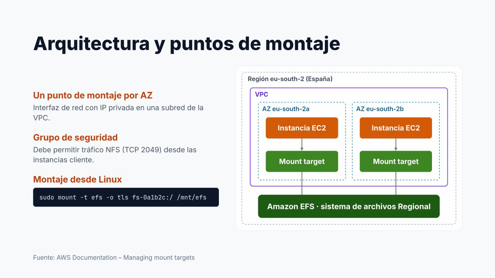

# Arquitectura y red: destinos de montaje



Para utilizar EFS hay que entender cómo se conecta con la red. El sistema de archivos es un **recurso regional**, pero las instancias no acceden a él directamente: lo hacen a través de los **destinos de montaje** (*mount targets*, también llamados puntos de montaje en las presentaciones).

---

## Destinos de montaje

Un destino de montaje es una **interfaz de red (ENI) con una dirección IP privada** dentro de una subred de la VPC.

- Se crea, como máximo, **un destino de montaje por zona de disponibilidad**.
- Las instancias de cada zona utilizan el destino de montaje **de su propia zona**. Así el tráfico se mantiene dentro de la AZ, lo que **reduce la latencia** y evita **costes de transferencia entre zonas**.
- Un sistema de archivos solo puede tener destinos de montaje **en una VPC** a la vez.

En el diagrama se observa una VPC en la región de España (`eu-south-2`) con dos zonas de disponibilidad. En cada zona hay una instancia EC2 y un destino de montaje, y ambos destinos dan acceso **al mismo sistema de archivos regional**: las dos instancias trabajan sobre los mismos ficheros.

!!! tip "Un destino de montaje en cada AZ que se utilice"
    Si las instancias de una AZ no tienen destino de montaje propio, pueden montar el de otra zona usando su dirección IP, pero el tráfico cruzará zonas (mayor latencia y coste) y dependerá de la disponibilidad de **otra** AZ. En producción se crea un destino de montaje **en cada zona** donde haya clientes, normalmente en **subredes privadas**.

### Resolución DNS

El asistente de montaje utiliza el nombre DNS del sistema de archivos:

```
fs-0123456789abcdef0.efs.us-east-1.amazonaws.com
```

Este nombre resuelve automáticamente a la IP del destino de montaje **de la AZ del cliente**. Para que funcione, la VPC debe tener activados los atributos **Resolución de DNS** y **Nombres de host DNS** (activos por defecto en la VPC predeterminada).

---

## Grupo de seguridad del destino de montaje

Cada destino de montaje lleva asociado uno o varios **grupos de seguridad**. Deben permitir el tráfico **NFS (TCP 2049)** desde las instancias que vayan a montar el sistema de archivos:

| Grupo | Regla | Puerto | Origen / destino |
| --- | --- | --- | --- |
| `efs-sg` (destinos de montaje) | Entrada | TCP **2049** (NFS) | `web-sg` (grupo de seguridad de los clientes) |
| `web-sg` (instancias cliente) | Salida | Todo el tráfico (predeterminado) | `0.0.0.0/0` |

Como en la unidad de bases de datos, la práctica recomendada es **referenciar el grupo de seguridad de los clientes** en lugar de rangos de IP: las nuevas instancias del grupo obtienen acceso automáticamente y ningún otro recurso de la VPC lo tiene.

=== "Consola AWS"

    **Crear el grupo de seguridad**

    1. **EC2 → Red y seguridad → Grupos de seguridad → Crear grupo de seguridad**.
    2. **Nombre**: `efs-sg`. **Descripción**: «NFS desde servidores web». **VPC**: la de las instancias.
    3. En **Reglas de entrada → Agregar regla**: **Tipo** `NFS` (rellena TCP 2049); **Origen** *Personalizada* y, en el buscador, el grupo de seguridad de los clientes (`web-sg`).
    4. Dejar las reglas de salida predeterminadas y pulsar **Crear grupo de seguridad**.

    **Asignarlo a los destinos de montaje** de un sistema existente

    1. **EFS → Sistemas de archivos**, seleccionar el sistema y abrir la pestaña **Red**.
    2. **Administrar**: en cada destino de montaje, quitar el grupo predeterminado y añadir `efs-sg`.
    3. **Guardar**.

=== "AWS CLI"

    ```bash
    aws ec2 create-security-group --group-name efs-sg \
      --description "NFS desde servidores web" --vpc-id vpc-0abc...
    aws ec2 authorize-security-group-ingress --group-id sg-efs... \
      --protocol tcp --port 2049 --source-group sg-web...

    # Asignarlo a un destino de montaje existente
    aws efs modify-mount-target-security-groups \
      --mount-target-id fsmt-0aaa... --security-groups sg-efs...
    ```

!!! warning "El error más frecuente en los laboratorios"
    Olvidar la regla de entrada **TCP 2049**. El síntoma es característico: el comando `mount` **se queda esperando** sin mostrar ningún error y, al cabo de un tiempo, falla por **tiempo de espera** (*Connection timed out*). Ante un montaje que «se cuelga», lo primero es revisar el grupo de seguridad del destino de montaje.

---

## Referencias

- AWS. *Managing mount targets* — [Destinos de montaje](https://docs.aws.amazon.com/efs/latest/ug/accessing-fs.html)
- AWS. *Using VPC security groups* — [Grupos de seguridad para EFS](https://docs.aws.amazon.com/efs/latest/ug/network-access.html)
