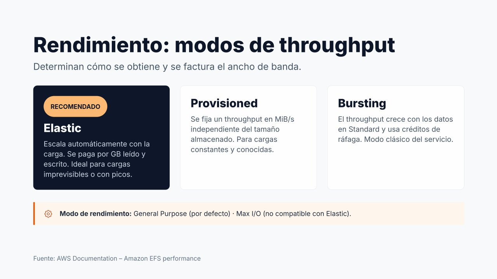

# Rendimiento de EFS



!!! info "Contenido de ampliación"
    Esta página es **opcional**. Desarrolla contenidos que en el núcleo de la unidad solo se mencionan. No es necesaria para realizar las prácticas.

A diferencia de EBS, en EFS no se eligen IOPS ni un tipo de disco. El rendimiento se configura con dos parámetros: el **modo de rendimiento** (*throughput mode*), que determina cómo obtiene el sistema de archivos su ancho de banda y cómo se factura, y el **modo de desempeño** (*performance mode*), que determina su comportamiento en latencia y paralelismo.

---

## Modos de rendimiento (*throughput*)

### Elastic (recomendado)

Es el **modo por defecto** y el recomendado por AWS para la mayoría de las cargas.

- El rendimiento **escala automáticamente**, hacia arriba y hacia abajo, según la actividad de la aplicación, sin necesidad de planificarlo.
- Se paga por la **cantidad de datos leídos y escritos** (por GB transferido), además del almacenamiento.
- Especialmente adecuado para cargas **impredecibles o con picos** puntuales, y para cargas con poca actividad media (se paga poco cuando no hay actividad).

### Provisioned (aprovisionado)

Permite **fijar un rendimiento concreto**, en **MiB/s**, independiente de la cantidad de datos almacenada.

- Útil cuando se conoce con precisión el rendimiento que necesita una aplicación de **carga constante** y se quiere **garantizar**.
- Se paga el rendimiento aprovisionado **haya o no actividad**.
- Tras cambiar a Provisioned o **aumentar** el valor, hay que esperar **al menos 24 horas** para volver a cambiar de modo o **reducirlo**.

### Bursting (ráfagas)

Es el modo **original** del servicio.

- El rendimiento base **crece en proporción a los datos almacenados en la clase Standard** (50 KiB/s por cada GiB).
- El sistema acumula **créditos** cuando consume menos que su base y los gasta para realizar **ráfagas** por encima de ella.
- Su inconveniente: un sistema de archivos **pequeño** dispone de muy poco rendimiento sostenido. Con 10 GiB almacenados, la base es de unos 0,5 MiB/s: cuando se agotan los créditos (métrica `BurstCreditBalance`), la aplicación se vuelve extremadamente lenta.

| Modo | Rendimiento | Se factura | Cuándo elegirlo |
| --- | --- | --- | --- |
| **Elastic** | Automático según la carga | GB leídos y escritos | **Por defecto**; cargas variables o desconocidas |
| **Provisioned** | Fijo, en MiB/s | MiB/s aprovisionados (por mes) | Carga constante y conocida, con alta actividad media |
| **Bursting** | Proporcional a los datos en Standard, con créditos | Solo el almacenamiento | Sistemas grandes con uso moderado; heredado |

!!! tip "Cómo decidir entre Elastic y Provisioned"
    AWS sugiere observar la relación entre el rendimiento **medio** y el **máximo** de la carga. Si la carga es muy irregular (media muy inferior al pico), Elastic suele ser más barato. Si la carga es alta y sostenida (la media se acerca al pico), Provisioned puede resultar más económico. El modo puede cambiarse **sin interrupción del servicio**.

---

## Modos de desempeño (*performance mode*)

| Modo | Características | Compatibilidad |
| --- | --- | --- |
| **General Purpose** (Uso general) | **Por defecto**. Menor latencia por operación. Adecuado en la práctica totalidad de los casos: web, CMS, directorios de usuario, contenedores | Todos los tipos y modos |
| **Max I/O** (E/S máxima) | Modo anterior pensado para cargas **muy paralelizadas**, con mayor latencia por operación | **No** compatible con Elastic **ni** con One Zone |

El modo de desempeño se elige **al crear** el sistema de archivos y no puede modificarse. Hoy, con General Purpose y Elastic, el uso de Max I/O es muy limitado.

!!! note "Configuración recomendada"
    Para la mayoría de aplicaciones: **General Purpose** + **Elastic**. Es la combinación que ofrece el mejor equilibrio entre simplicidad, coste, escalabilidad y rendimiento.

### Cambiar el modo de rendimiento

=== "Consola AWS"

    1. **EFS → Sistemas de archivos**, seleccionar el sistema.
    2. En la sección **General**, pulsar **Editar**.
    3. En **Modo de rendimiento**, elegir **Mejorado** y después **Elástico** o **Aprovisionado** (indicando los **MiB/s**), o bien **Ráfagas**.
    4. **Guardar cambios**. El cambio no interrumpe a los clientes conectados.

    Si se acaba de pasar a Aprovisionado o de aumentar su valor, la consola no permitirá volver a cambiar el modo ni reducirlo hasta pasadas 24 horas.

=== "AWS CLI"

    ```bash
    # Pasar a Provisioned con 128 MiB/s
    aws efs update-file-system --file-system-id fs-0abc... \
      --throughput-mode provisioned --provisioned-throughput-in-mibps 128

    # Volver a Elastic (respetando la espera de 24 h si se acaba de aumentar)
    aws efs update-file-system --file-system-id fs-0abc... --throughput-mode elastic

    # Consultar el modo actual
    aws efs describe-file-systems --file-system-id fs-0abc... \
      --query "FileSystems[0].[ThroughputMode,ProvisionedThroughputInMibps]"
    ```

---

## Referencias

- AWS. *Amazon EFS performance* — [Rendimiento](https://docs.aws.amazon.com/efs/latest/ug/performance.html)
- AWS. *Managing file system throughput* — [Cambio del modo de rendimiento](https://docs.aws.amazon.com/efs/latest/ug/managing-throughput.html)
- AWS. *Amazon EFS use cases* — [Casos de uso](https://aws.amazon.com/efs/when-to-choose-efs/)
- AWS. *Using Amazon EFS file systems with Amazon ECS* — [EFS con ECS](https://docs.aws.amazon.com/AmazonECS/latest/developerguide/efs-volumes.html)
- AWS. *Configuring file system access for Lambda functions* — [EFS con Lambda](https://docs.aws.amazon.com/lambda/latest/dg/configuration-filesystem.html)
