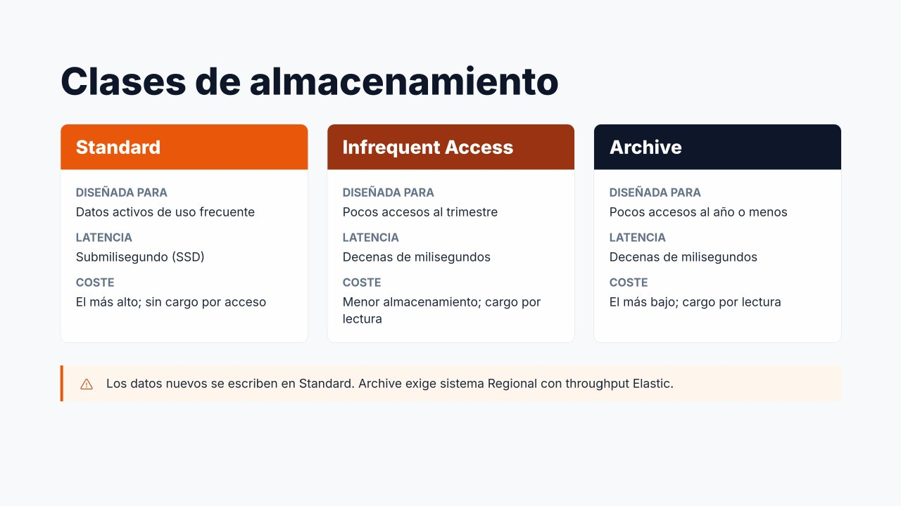
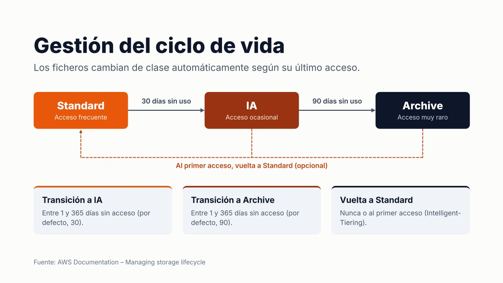

# Clases de almacenamiento y gestión del ciclo de vida



No todos los ficheros se usan con la misma frecuencia. En un servidor de ficheros típico, una pequeña parte de los datos se consulta a diario, mientras que la mayoría (documentos antiguos, versiones anteriores, registros) apenas se vuelve a abrir. Pagar el mismo precio por todos ellos es un desperdicio. EFS resuelve este problema con **clases de almacenamiento** y una **política de ciclo de vida** que mueve los ficheros automáticamente entre ellas.

---

## Clases de almacenamiento

| Clase                      | Diseñada para                                                                             | Latencia                              | Coste de almacenamiento | Coste de acceso                                           |
| -------------------------- | ----------------------------------------------------------------------------------------- | ------------------------------------- | ----------------------- | --------------------------------------------------------- |
| **Standard**               | Datos **activos** de uso frecuente                                                        | **Submilisegundo** (SSD)              | El más alto             | Sin cargo por lectura (en Elastic se paga el rendimiento) |
| **Infrequent Access (IA)** | Ficheros a los que se accede **pocas veces al trimestre**                                 | Decenas de milisegundos (primer byte) | Mucho menor             | **Cargo por lectura** y por transición                    |
| **Archive**                | Datos de larga duración, accedidos **pocas veces al año o menos** (históricos, normativa) | Decenas de milisegundos               | **El más bajo**         | **Cargo por lectura** y por transición                    |

Aspectos clave:

- **Un mismo sistema de archivos puede contener ficheros en las tres clases a la vez.** Para la aplicación el cambio es **completamente transparente**: la ruta del fichero no cambia y se sigue leyendo con normalidad (solo con algo más de latencia).
- **Todos los datos nuevos se escriben siempre en Standard.**
- La clase **Archive** requiere un sistema de archivos **Regional** con modo de rendimiento **Elastic**.
- En los sistemas **One Zone** existen las clases equivalentes *One Zone* (Standard) y *One Zone-IA*, pero **no Archive**.
- En IA y Archive se factura un **mínimo de 128 KiB por fichero**: un fichero de 4 KiB en IA se cobra como si ocupara 128 KiB. Por eso estas clases resultan poco interesantes cuando la mayoría de los ficheros son muy pequeños.
- Archive tiene además una **permanencia mínima de 90 días**: un fichero que sale de Archive antes se factura como si hubiera permanecido ese tiempo.

Si todos los datos nuevos van a Standard, ¿cómo llegan los ficheros a IA o Archive? La respuesta es la **gestión del ciclo de vida**.

---

## Gestión del ciclo de vida (*Lifecycle Management*)



La gestión del ciclo de vida mueve automáticamente los ficheros entre clases **en función del tiempo transcurrido desde su último acceso**. Se configura a nivel de sistema de archivos mediante una **política de ciclo de vida**, que puede definirse desde la consola, la AWS CLI, la API o como infraestructura como código.

La política tiene tres parámetros:

| Parámetro                                                     | Función                                                          | Valores                                                |
| ------------------------------------------------------------- | ---------------------------------------------------------------- | ------------------------------------------------------ |
| **Transición a IA** (`TransitionToIA`)                        | Días sin acceso tras los cuales un fichero pasa de Standard a IA | 1, 7, 14, 30, 60, 90, 180, 270 o 365 días, o *Ninguna* |
| **Transición a Archive** (`TransitionToArchive`)              | Días sin acceso tras los cuales pasa a Archive                   | Mismos valores, o *Ninguna*                            |
| **Transición a Standard** (`TransitionToPrimaryStorageClass`) | Si el fichero vuelve a Standard cuando se utiliza                | *Ninguna* o **Al primer acceso**                       |

Cuando se crea un sistema de archivos desde la consola, AWS aplica una **política recomendada**: los ficheros pasan a **IA tras 30 días** sin acceso y a **Archive tras 90 días**. Es un buen punto de partida para la mayoría de los casos.

### EFS Intelligent-Tiering

Por defecto, un fichero que se ha movido a IA o Archive **permanece allí** aunque vuelva a leerse, y cada lectura tiene un cargo. Si se configura la transición a Standard **«al primer acceso»**, el fichero **regresa automáticamente a Standard** en cuanto se utiliza.

La combinación de las transiciones hacia IA/Archive con la vuelta al primer acceso se conoce como **EFS Intelligent-Tiering**. Es especialmente útil cuando **no se conoce bien el patrón de acceso** de los datos: lo que se usa se mantiene rápido y lo que deja de usarse se abarata.

### Matices importantes

- Los **metadatos** del sistema de archivos (nombres, estructura de directorios, permisos) permanecen **siempre en Standard**, de modo que listar directorios sigue siendo rápido aunque los ficheros estén en Archive.
- Cada **transición** entre clases tiene un pequeño coste. Hay que evitar políticas que provoquen **movimientos constantes** de los mismos ficheros (por ejemplo, transición a IA tras 1 día con vuelta al primer acceso para ficheros que se leen cada dos días).
- Leer datos de IA o Archive tiene un **coste de recuperación**: es exactamente el «coste de recuperación» que menciona el criterio de evaluación al escoger la clase.

---

## Configurar la política de ciclo de vida

=== "Consola AWS"

    1. **EFS → Sistemas de archivos**, seleccionar el sistema.
    2. En la sección **General**, pulsar **Editar**.
    3. En **Administración del ciclo de vida**:
        - **Transición a IA**: *30 días desde el último acceso*.
        - **Transición a Archive**: *90 días desde el último acceso*.
        - **Transición a Standard**: *Al primer acceso*.
    4. **Guardar cambios**.
    
    Para **desactivar** el ciclo de vida se selecciona *Ninguna* en las tres opciones. La política vigente se consulta en la sección **General** del sistema de archivos.

=== "AWS CLI"

    ```bash
    # Política recomendada con Intelligent-Tiering
    aws efs put-lifecycle-configuration --file-system-id fs-0abc... \
      --lifecycle-policies \
        '[{"TransitionToIA":"AFTER_30_DAYS"},
          {"TransitionToArchive":"AFTER_90_DAYS"},
          {"TransitionToPrimaryStorageClass":"AFTER_1_ACCESS"}]'
    
    # Consultar la política vigente
    aws efs describe-lifecycle-configuration --file-system-id fs-0abc...
    
    # Desactivar el ciclo de vida (todos los ficheros nuevos se quedan en Standard)
    aws efs put-lifecycle-configuration --file-system-id fs-0abc... --lifecycle-policies '[]'
    ```

!!! note "Cambiar la clase durante el ciclo de vida"
    Modificar la política es la forma de **cambiar la clase de almacenamiento** de los datos de un sistema EFS: no se mueven ficheros a mano. Al desactivar la política, los ficheros que ya están en IA o Archive **no vuelven** a Standard por sí solos; volverán al leerse si está configurada la transición al primer acceso.

### Comprobar el efecto

La métrica de CloudWatch **`StorageBytes`**, con la dimensión `StorageClass` (`Total`, `Standard`, `IA`, `Archive`), muestra cuántos datos hay en cada clase. También puede consultarse el tamaño medido:

=== "Consola AWS"

    - En **EFS → Sistemas de archivos**, la columna **Tamaño medido** y, al abrir el sistema, la sección **Tamaño medido** desglosan el espacio en Standard, IA y Archive.
    - La pestaña **Supervisión** del sistema muestra las gráficas de CloudWatch, entre ellas el almacenamiento por clase.

=== "AWS CLI"

    ```bash
    aws efs describe-file-systems --file-system-id fs-0abc... \
      --query "FileSystems[0].SizeInBytes"
    ```

---

## Ejemplo: efecto en el coste

Un sistema de archivos con **1.000 GB** en el que solo el **20 %** de los ficheros se usa cada mes (precios aproximados de `us-east-1`):

| Configuración      | Cálculo                  | Coste mensual aproximado      |
| ------------------ | ------------------------ | ----------------------------- |
| Todo en Standard   | 1.000 GB × 0,30 USD      | **300 USD**                   |
| Ciclo de vida a IA | 200 × 0,30 + 800 × 0,016 | **≈ 73 USD** + lecturas de IA |

El ciclo de vida reduce el coste de almacenamiento en más de un 75 %, siempre que los datos fríos sean realmente fríos. Si se leyeran a menudo, los cargos por lectura anularían el ahorro: para eso existe la vuelta a Standard al primer acceso.

---

## Ejemplo de elección de política

| Escenario                                             | Política                                            | Justificación                                                                                    |
| ----------------------------------------------------- | --------------------------------------------------- | ------------------------------------------------------------------------------------------------ |
| Contenido de un WordPress (imágenes subidas)          | IA a 30 días, Archive a 90, vuelta al primer acceso | Las imágenes antiguas se ven poco, pero si una entrada antigua se hace popular vuelve a Standard |
| Directorios de usuario                                | IA a 30 días, vuelta al primer acceso               | Muchos documentos olvidados; los que se usan, rápidos                                            |
| Repositorio de artefactos de CI/CD                    | IA a 14 días, sin vuelta                            | Los artefactos antiguos casi nunca se reutilizan                                                 |
| Datos de entrenamiento de ML leídos en cada ejecución | Sin ciclo de vida                                   | Se leen constantemente: IA saldría más caro por los cargos de lectura                            |
| Documentación que debe conservarse 10 años            | IA a 7 días, Archive a 30                           | Prima el coste de almacenamiento; el acceso es excepcional                                       |

Una buena política de ciclo de vida permite **reducir de forma significativa el coste** sin intervención manual, lo que conecta con el criterio de **ajustar los parámetros que afectan a los costes**.

---

## Referencias

- AWS. *EFS storage classes* — [Clases de almacenamiento](https://docs.aws.amazon.com/efs/latest/ug/storage-classes.html)
- AWS. *Managing storage lifecycle* — [Ciclo de vida](https://docs.aws.amazon.com/efs/latest/ug/lifecycle-management-efs.html)
- AWS. *PutLifecycleConfiguration* — [Referencia de la API](https://docs.aws.amazon.com/efs/latest/ug/API_PutLifecycleConfiguration.html)
- AWS. *Amazon EFS pricing* — [Precios](https://aws.amazon.com/efs/pricing/)
