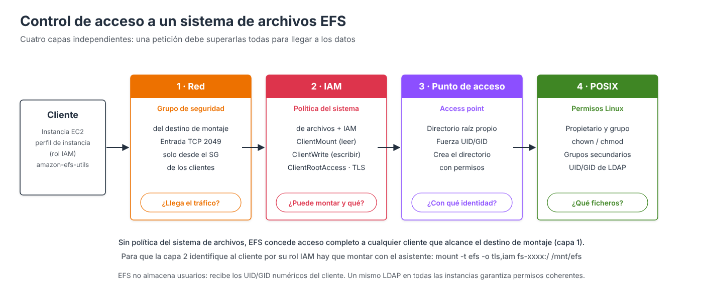

# Políticas del sistema de archivos y permisos



!!! tip "Vídeo de apoyo"
    Este apartado se corresponde con el vídeo [**Políticas de sistemas EFS**](https://drive.google.com/file/d/1s_at6LPaKOKEYPhaKsetua0Fvll17oNM/view), que muestra el último paso del asistente de creación.

El acceso a un sistema de archivos EFS se controla en **cuatro capas independientes**. Es el punto donde suele haber más confusión, porque se mezclan **permisos de AWS** (quién puede montar el sistema de archivos y cómo) con los **permisos tradicionales de Linux** (qué puede hacer cada usuario con cada fichero una vez montado).

| Capa | Pregunta que responde | Mecanismo |
| --- | --- | --- |
| **1. Red** | ¿Puede el cliente llegar al sistema de archivos? | Grupo de seguridad del destino de montaje (TCP 2049) |
| **2. IAM** | ¿Puede montarlo? ¿Puede escribir? ¿Puede actuar como *root*? ¿Debe usar TLS? | **Política del sistema de archivos** y políticas de IAM |
| **3. Punto de acceso** | ¿Con qué identidad y en qué directorio trabaja la aplicación? | *Access points* (apartado siguiente) |
| **4. POSIX** | ¿Qué ficheros puede leer o modificar cada usuario? | Propietario, grupo, `chown`, `chmod` |

La capa de red se estudió en el apartado de arquitectura; este apartado se centra en las capas **2** y **4**.

---

## La política del sistema de archivos

La **política del sistema de archivos** (*file system policy*) es una **política de IAM basada en recursos** asociada al sistema de archivos, similar a la política de un *bucket* de S3. Controla **quién puede montar y utilizar** el sistema de archivos desde AWS, pero **no sustituye a los permisos de Linux**: una vez montado, la gestión de propietarios, grupos y permisos sigue haciéndose con permisos POSIX, igual que en cualquier sistema de ficheros Linux.

### Comportamiento por defecto

!!! warning "Sin política, el acceso es completo"
    Si no se define ninguna política, EFS aplica una **política predeterminada** que **concede acceso completo (incluido *root*) a cualquier cliente anónimo que pueda conectarse a un destino de montaje**. La única protección es entonces el grupo de seguridad. Es cómodo para un laboratorio, pero no es una configuración adecuada para producción.

### Acciones de cliente

La política trabaja con tres acciones específicas para los clientes NFS:

| Acción | Permite |
| --- | --- |
| `elasticfilesystem:ClientMount` | Montar el sistema de archivos con acceso de **solo lectura** |
| `elasticfilesystem:ClientWrite` | **Escribir** en el sistema de archivos |
| `elasticfilesystem:ClientRootAccess` | Actuar como usuario **root** (UID 0) sobre el sistema de archivos |

Y con estas claves de condición, las únicas que EFS evalúa para los clientes NFS:

| Clave de condición | Uso |
| --- | --- |
| `aws:SecureTransport` | Exigir **TLS** (cifrado en tránsito) |
| `elasticfilesystem:AccessedViaMountTarget` | Permitir solo el acceso a través de los destinos de montaje |
| `elasticfilesystem:AccessPointArn` | Permitir el acceso solo a través de un **punto de acceso** concreto |
| `aws:SourceIp` | Restringir por IP de origen (solo rangos públicos) |

!!! warning "Basta con que lo permita una de las dos políticas"
    Un permiso concedido **en la política del sistema de archivos o en la política de IAM** de la identidad es suficiente: no es necesario que figure en ambas. Solo un **`Deny` explícito**, en cualquiera de ellas, lo anula.

    Esto es clave en el Learner Lab: la política de IAM de **`LabRole`** concede permisos amplios sobre EFS, **incluido `ClientRootAccess`**. Por eso, aunque la política del sistema de archivos no conceda ese permiso, las instancias con `LabRole` siguen actuando como *root*. Para impedirlo hay que **denegarlo explícitamente** (ver más abajo).

---

## Opciones predefinidas de la consola

En el paso **Política del sistema de archivos** del asistente (o en la pestaña del mismo nombre de un sistema existente), la consola ofrece cuatro casillas que generan la política automáticamente. El JSON resultante se muestra en el **editor de políticas**, donde puede ajustarse a mano.

### Impedir el acceso raíz por defecto

Elimina `ClientRootAccess` de las acciones que la política concede. Si el cliente no obtiene ese permiso por ninguna otra vía, cuando opera como *root* se le trata como un usuario **sin privilegios** (UID/GID **65534**, `nobody`): es lo que en NFS se conoce como ***root squashing***. Hay que tener en cuenta que, **sin política, EFS no aplica root squashing** (`no_root_squash`): el *root* del cliente es *root* en el sistema de archivos.

!!! danger "Si el rol concede `ClientRootAccess`, la casilla no basta"
    Quitar `ClientRootAccess` de la política del sistema de archivos **no impide** el acceso *root* a una identidad cuya política de IAM ya lo concede, como `LabRole` en el Learner Lab. En ese caso hay que añadir una sentencia **`Deny`** explícita:

    ```json
    {
      "Sid": "ForzarRootSquash",
      "Effect": "Deny",
      "Principal": { "AWS": "*" },
      "Action": "elasticfilesystem:ClientRootAccess",
      "Resource": "arn:aws:elasticfilesystem:us-east-1:111122223333:file-system/fs-0abc123"
    }
    ```

    Tras añadirla, hay que **desmontar y volver a montar**: los permisos se evalúan al conectar.

Durante años fue habitual permitir el acceso *root* en NFS para facilitar la administración, pero hoy la recomendación es la contraria. El motivo es sencillo: si una instancia EC2 resulta comprometida y un atacante obtiene privilegios de *root* en ella, podría acceder a **cualquier fichero** del sistema de archivos compartido, sea quien sea su propietario. Impidiendo el acceso *root*, los privilegios administrativos de una máquina cliente **no se trasladan** al almacenamiento compartido.

**Recomendación: habilitarla** en la mayoría de los entornos, en especial con requisitos de seguridad elevados. Solo debería desactivarse con una necesidad operativa justificada.

!!! warning "Preparar la estructura de directorios antes"
    El directorio raíz de un EFS recién creado pertenece a `root:root` con permisos `755`. Si se impide el acceso *root* **antes** de crear los directorios de trabajo y asignar sus propietarios, nadie podrá hacerlo: el *root* de los clientes ya no es *root* para EFS. Las alternativas son crear la estructura **antes** de aplicar el `Deny` (es lo que se hace en la práctica 3), conceder `ClientRootAccess` solo a una **identidad de administración**, o utilizar **puntos de acceso**, que crean el directorio con el propietario indicado.

### Aplicar acceso de solo lectura por defecto

Elimina `ClientWrite` de las acciones permitidas: los clientes solo pueden **leer**. Igual que con el acceso *root*, si la política de IAM del rol concede `ClientWrite` (caso de `LabRole`), hace falta un **`Deny` explícito** de `ClientWrite` para forzar la solo lectura.

Es útil para repositorios de documentación, contenido estático o datos de referencia que no deban modificarse. En la mayoría de las implementaciones generales las aplicaciones necesitan escribir, por lo que normalmente **permanece deshabilitada**; lo habitual es conceder la escritura solo a determinadas identidades.

### Evitar el acceso anónimo

Elimina `ClientMount` de las acciones concedidas a cualquier cliente: ya **no basta con llegar al destino de montaje**. Solo pueden montar los clientes que se **identifican con IAM** (por ejemplo, con el rol del perfil de instancia) y tienen el permiso concedido en su política de IAM o en la política del sistema de archivos.

Es una buena práctica de seguridad y se recomienda mantenerla **habilitada** para garantizar que todos los accesos están identificados (y quedan registrados en CloudTrail con la identidad del cliente).

!!! note "Identificarse con IAM al montar"
    Para que EFS conozca la identidad IAM del cliente, este debe montar con el **asistente de montaje** y la opción **`iam`** (que exige también `tls`):

    ```bash
    sudo mount -t efs -o tls,iam fs-0abc...:/ /mnt/efs
    ```

    Sin la opción `iam`, el cliente se presenta como **anónimo**. Si la política no concede nada a los anónimos, el montaje falla con *access denied by server*.

### Aplicar el cifrado en tránsito para todos los clientes

Añade una sentencia que **deniega** cualquier acceso que no utilice TLS (`aws:SecureTransport = false`). Obliga a que todas las conexiones usen cifrado durante la transmisión, de modo que la información no pueda interceptarse ni inspeccionarse en la red.

**Recomendación: habilitarla** en cualquier entorno de producción. Los clientes deberán montar con la opción `tls`.

| Casilla | Efecto en la política | Recomendación |
| --- | --- | --- |
| Impedir el acceso raíz por defecto | Retira `ClientRootAccess` (con `LabRole`, añadir además el `Deny`) | ✅ Habilitar |
| Aplicar acceso de solo lectura por defecto | Retira `ClientWrite` | Según el caso (normalmente no) |
| Evitar el acceso anónimo | Retira `ClientMount` a los clientes no identificados | ✅ Habilitar |
| Aplicar cifrado en tránsito | Deniega el acceso sin TLS | ✅ Habilitar |

---

## Ejemplos de políticas

### Lectura y escritura para un rol, sin *root* y con TLS obligatorio

La política siguiente concede a las instancias que usan el rol `LabRole` (el rol del perfil de instancia `LabInstanceProfile` del Learner Lab) permiso para montar y escribir **a través de los destinos de montaje**, **deniega** el acceso *root* y **deniega** cualquier conexión sin TLS.

!!! tip "¿Qué ARN se pone en `Principal`?"
    Desde la instancia, `aws sts get-caller-identity` devuelve un ARN **temporal** de STS (`arn:aws:sts::<cuenta>:assumed-role/LabRole/i-...`). En la política hay que usar el ARN **permanente del rol**: `arn:aws:iam::<cuenta>:role/LabRole`. El motivo se explica en el anexo [ARN temporal de STS frente al ARN del rol IAM](anexo-sts-role.md).

```json
{
  "Version": "2012-10-17",
  "Statement": [
    {
      "Sid": "LecturaEscrituraServidoresWeb",
      "Effect": "Allow",
      "Principal": { "AWS": "arn:aws:iam::111122223333:role/LabRole" },
      "Action": [
        "elasticfilesystem:ClientMount",
        "elasticfilesystem:ClientWrite"
      ],
      "Resource": "arn:aws:elasticfilesystem:us-east-1:111122223333:file-system/fs-0abc123",
      "Condition": {
        "Bool": { "elasticfilesystem:AccessedViaMountTarget": "true" }
      }
    },
    {
      "Sid": "ForzarRootSquash",
      "Effect": "Deny",
      "Principal": { "AWS": "*" },
      "Action": "elasticfilesystem:ClientRootAccess",
      "Resource": "arn:aws:elasticfilesystem:us-east-1:111122223333:file-system/fs-0abc123"
    },
    {
      "Sid": "ExigirTLS",
      "Effect": "Deny",
      "Principal": { "AWS": "*" },
      "Action": "*",
      "Resource": "arn:aws:elasticfilesystem:us-east-1:111122223333:file-system/fs-0abc123",
      "Condition": {
        "Bool": { "aws:SecureTransport": "false" }
      }
    }
  ]
}
```

### Aplicar la política

=== "Consola AWS"

    1. **EFS → Sistemas de archivos**, seleccionar el sistema y abrir la pestaña **Política del sistema de archivos**.
    2. Pulsar **Editar**.
    3. Marcar las **opciones predefinidas** deseadas o pegar el JSON en el **Editor de políticas**. Al editar el JSON a mano, las casillas se desactivan hasta pulsar **Borrar**.
    4. **Guardar**. La política vigente queda visible en la misma pestaña.

    Para volver a la política predeterminada (acceso completo anónimo) se elimina la política desde esa pestaña.

=== "AWS CLI"

    ```bash
    aws efs put-file-system-policy --file-system-id fs-0abc123 \
      --policy file://politica-efs.json

    aws efs describe-file-system-policy --file-system-id fs-0abc123

    # Volver a la política predeterminada (acceso completo anónimo)
    aws efs delete-file-system-policy --file-system-id fs-0abc123
    ```

---

## EFS, LDAP y permisos de usuario

Cuando se trabaja con **LDAP, Active Directory, FreeIPA** o cualquier otro directorio corporativo, es importante entender que **Amazon EFS no almacena usuarios ni grupos**. El sistema de archivos solo recibe los **identificadores numéricos** de usuario y grupo (**UID** y **GID**) que envían los clientes Linux en cada operación NFS.

| Usuario | UID | Grupo | GID |
| --- | --- | --- | --- |
| juan | 1001 | desarrolladores | 2001 |

Esto tiene una consecuencia práctica: si en una instancia `juan` tiene UID 1001 y en otra el UID 1001 corresponde a `maria`, **`maria` verá los ficheros de `juan` como propios**. Si todas las instancias utilizan **el mismo LDAP**, comparten los mismos UID y GID y los permisos funcionan de forma **coherente en cualquier servidor**.

La gestión de permisos se realiza exactamente igual que en cualquier sistema Linux:

```bash
sudo mkdir /mnt/efs/proyecto
sudo chown juan:desarrolladores /mnt/efs/proyecto
sudo chmod 770 /mnt/efs/proyecto            # propietario y grupo: todo; resto: nada

# Directorio de un segundo grupo: setgid para que lo nuevo herede el grupo
sudo mkdir /mnt/efs/informes
sudo chgrp auditores /mnt/efs/informes
sudo chmod 2750 /mnt/efs/informes
```

!!! note "ACL"
    EFS aplica los **permisos POSIX clásicos** (propietario, grupo y otros, con los bits especiales `setuid`, `setgid` y *sticky*). Las ACL POSIX que se gestionan con `setfacl` **no funcionan sobre montajes NFS v4**, por lo que una gestión más granular se resuelve combinando **grupos** (incluidos los grupos secundarios del directorio corporativo) y **puntos de acceso**.

Los permisos se administran **en el propio sistema de archivos y en el directorio corporativo**, no en Amazon EFS: **EFS proporciona el almacenamiento compartido; LDAP o Active Directory proporcionan la identidad** de los usuarios. Cuando no hay directorio corporativo (por ejemplo, contenedores o funciones Lambda), los **puntos de acceso** permiten imponer una identidad fija.

---

## Recomendación para un entorno corporativo típico

Para un EFS compartido entre varias instancias Linux integradas con LDAP o Active Directory:

- ✅ Impedir el acceso raíz (con un `Deny` explícito de `ClientRootAccess` si el rol lo concede).
- ✅ Evitar el acceso anónimo y montar con `-o tls,iam`.
- ✅ Exigir cifrado en tránsito.
- ✅ Gestionar usuarios y grupos mediante LDAP o Active Directory.
- ✅ Administrar permisos con propietarios, grupos y permisos POSIX.
- ✅ Utilizar grupos de seguridad e IAM para controlar qué sistemas pueden montar el EFS.

Con esta configuración se obtiene un equilibrio adecuado entre **seguridad**, **administración centralizada de usuarios** y **protección frente al compromiso de un servidor individual**.

---

## Referencias

- AWS. *Using IAM to control access to file systems* — [Control de acceso con IAM](https://docs.aws.amazon.com/efs/latest/ug/iam-access-control-nfs-efs.html)
- AWS. *Creating file system policies* — [Políticas del sistema de archivos](https://docs.aws.amazon.com/efs/latest/ug/create-file-system-policy.html)
- AWS. *Resource-based policy examples for Amazon EFS* — [Ejemplos de políticas](https://docs.aws.amazon.com/efs/latest/ug/security_iam_resource-based-policy-examples.html)
- AWS. *Enable root squashing using IAM authorization for NFS clients* — [Root squashing](https://docs.aws.amazon.com/efs/latest/ug/enable-root-squashing.html)
- AWS. *Network File System (NFS) level users, groups, and permissions* — [Permisos NFS](https://docs.aws.amazon.com/efs/latest/ug/accessing-fs-nfs-permissions.html)
- AWS. *Blocking public access to EFS file systems* — [Bloqueo del acceso público](https://docs.aws.amazon.com/efs/latest/ug/access-control-block-public-access.html)
- Classmethod. *¿Se bloquea el acceso anónimo con una política que solo permite autenticación IAM?* — [Prueba práctica](https://dev.classmethod.jp/articles/amazon-efs-iam-auth-deny-anonymous-access/)
