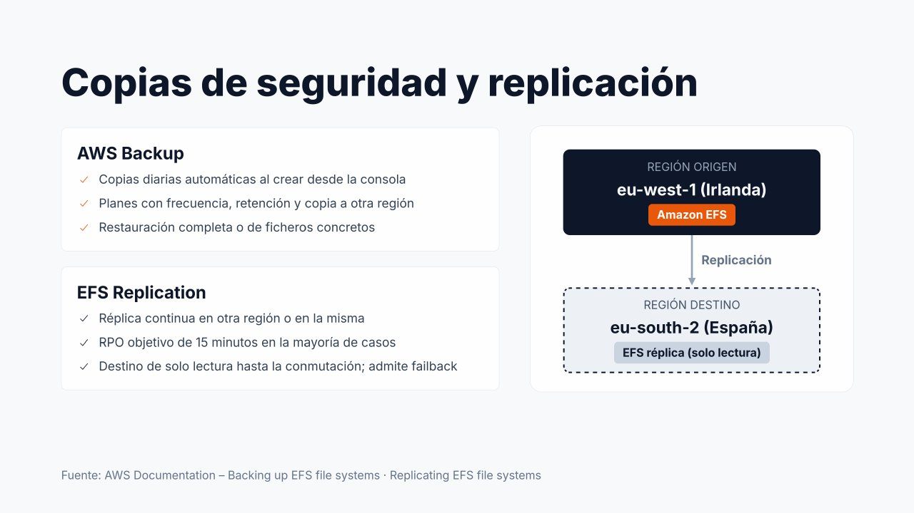

# Copias de seguridad y replicación de EFS



La alta durabilidad de EFS (once nueves) protege frente a la **pérdida de hardware**, pero no frente a un usuario que borra un directorio, una aplicación que corrompe ficheros o un incidente que afecta a toda la región. Para proteger los datos se dispone de dos mecanismos **complementarios**: **AWS Backup** y **EFS Replication**.

---

## AWS Backup

**AWS Backup** es el servicio **centralizado** de copias de seguridad de AWS. Gestiona con las mismas herramientas las copias de EFS, EBS, RDS, DynamoDB y otros servicios.

### Copias automáticas

Al crear un sistema de archivos desde la consola, las **copias automáticas están activadas por defecto**: AWS Backup aplica un plan predeterminado con **una copia diaria** y **retención de 35 días**, guardada en el almacén `aws/efs/automatic-backup-vault`.

=== "Consola AWS"

    1. **EFS → Sistemas de archivos**, seleccionar el sistema.
    2. En la sección **General**, el campo **Copias de seguridad automáticas** indica si están *Habilitadas*.
    3. Para cambiarlo: **Editar**, marcar o desmarcar **Habilitar las copias de seguridad automáticas** y **Guardar cambios**.

=== "AWS CLI"

    ```bash
    aws efs describe-backup-policy --file-system-id fs-0abc123
    aws efs put-backup-policy --file-system-id fs-0abc123 --backup-policy Status=ENABLED
    ```

Si se necesita otra frecuencia, otra retención o copiar las copias a otra región, se crean **planes de copia propios** en AWS Backup (ver [Copias de seguridad y recuperación](ALM-Recuperacion.md)).

### Restauración

A partir de un **punto de recuperación** puede restaurarse:

| Tipo | Destino | Uso |
| --- | --- | --- |
| **Restauración completa** | Un sistema de archivos **nuevo**, o el **mismo** sistema de archivos | Pérdida grave, clonación de un entorno |
| **Restauración parcial** | Solo determinados **ficheros o directorios** (hasta un número limitado de rutas) | Un usuario borró una carpeta |

Cuando se restaura sobre el **mismo** sistema de archivos, los datos **no sobrescriben** el contenido actual: se recuperan en un directorio nuevo llamado `aws-backup-restore_<fecha>` en la raíz, desde el que el administrador copia lo que necesite.

=== "Consola AWS"

    **Localizar las copias**

    1. **AWS Backup → Recursos protegidos**, seleccionar el sistema de archivos `fs-0abc123`.
    2. La lista **Puntos de recuperación** muestra cada copia con su fecha, estado y almacén.

    **Restaurar**

    1. Seleccionar el punto de recuperación y pulsar **Restaurar**.
    2. **Tipo de restauración**: **Restaurar todo el sistema de archivos** o **Restaurar elementos específicos** (indicando las rutas, por ejemplo `/web/uploads/2026`).
    3. **Destino**: **Restaurar en un nuevo sistema de archivos** (con su tipo, cifrado y rendimiento) o **Restaurar en el sistema de archivos de origen** (en el directorio `aws-backup-restore_<fecha>`).
    4. **Rol de restauración**: el rol predeterminado o `LabRole`.
    5. **Restaurar copia de seguridad**. El progreso se sigue en **AWS Backup → Trabajos → Trabajos de restauración**.

=== "AWS CLI"

    ```bash
    # Listar los puntos de recuperación del sistema de archivos
    aws backup list-recovery-points-by-resource \
      --resource-arn arn:aws:elasticfilesystem:us-east-1:111122223333:file-system/fs-0abc123

    # Restauración parcial de una ruta sobre el sistema de origen
    aws backup start-restore-job \
      --recovery-point-arn <arn-punto-recuperacion> \
      --iam-role-arn arn:aws:iam::111122223333:role/LabRole \
      --resource-type EFS \
      --metadata '{"file-system-id":"fs-0abc123","newFileSystem":"false","Encrypted":"true","ItemsToRestore":"[\"/web/uploads/2026\"]"}'

    aws backup list-restore-jobs --by-resource-type EFS
    ```

---

## EFS Replication

**EFS Replication** mantiene una **réplica** del sistema de archivos **en otra región o en la misma región** (también en otra cuenta).

| Característica | Detalle |
| --- | --- |
| **Funcionamiento** | Replicación **continua** y automática, sin servidores ni scripts |
| **RPO objetivo** | **15 minutos** para la mayoría de los sistemas de archivos |
| **Destino** | Un sistema de archivos nuevo creado por la replicación, o uno existente |
| **Estado del destino** | **Solo lectura** mientras la replicación está activa |
| **Configuración del destino** | Puede ser Regional u One Zone, con su propia clave KMS y política de ciclo de vida |
| **Métrica** | `TimeSinceLastSync`: tiempo desde la última sincronización completada |

En el diagrama, un sistema de archivos productivo en **Irlanda** (`eu-west-1`) se replica en **España** (`eu-south-2`).

=== "Consola AWS"

    1. En la región de **origen**, **EFS → Sistemas de archivos**, seleccionar el sistema y abrir la pestaña **Replicación**.
    2. **Crear replicación**.
    3. **Configuración de destino**: **Nuevo sistema de archivos** (o un sistema existente), **Región de destino** `eu-south-2`, tipo **Regional** u **One Zone** y clave de KMS de la región de destino.
    4. **Crear replicación**. La pestaña muestra el sistema de destino, su estado y la **Hora de la última sincronización**.

=== "AWS CLI"

    ```bash
    # Ejecutado en la región de ORIGEN
    aws efs create-replication-configuration \
      --source-file-system-id fs-0abc123 \
      --destinations Region=eu-south-2

    aws efs describe-replication-configurations --file-system-id fs-0abc123
    ```

Si la región de origen sufre una incidencia, se **elimina la configuración de replicación**: el sistema de destino pasa a admitir escritura y se convierte en el nuevo principal (*failover*). Resuelta la incidencia, se replica en sentido inverso para volver a la región original (*failback*). El procedimiento completo está en el apartado «Para saber más» de [Copias de seguridad y recuperación](ALM-Recuperacion.md#para-saber-mas).

---

## Copias frente a replicación

Es importante distinguir el propósito de cada mecanismo:

| Aspecto | AWS Backup | EFS Replication |
| --- | --- | --- |
| **Protege frente a** | Errores humanos, borrados, corrupción, *ransomware* | Pérdida de la región (o de la AZ en One Zone) |
| **Versiones del pasado** | **Sí**: un punto de recuperación por cada copia | **No**: la réplica es el estado actual |
| **Borrados accidentales** | Se recuperan de una copia anterior | **Se replican también** al destino |
| **RPO** | El intervalo entre copias (horas) | Minutos (objetivo 15 min) |
| **RTO** | Lo que tarde la restauración (crece con el volumen de datos) | Bajo: el destino ya está listo para montarse |
| **Coste** | Almacenamiento de las copias | Un segundo sistema de archivos completo + transferencia entre regiones |

La replicación protege frente a la **pérdida de una región**, pero **no frente a errores humanos**: si un usuario borra un fichero, el borrado se replica. Las copias de AWS Backup conservan **versiones del pasado**. Por este motivo, en una arquitectura empresarial lo habitual es **combinar ambos**.

---

## Referencias

- AWS. *Backing up EFS file systems* — [Copias de seguridad](https://docs.aws.amazon.com/efs/latest/ug/awsbackup.html)
- AWS. *Restoring an Amazon EFS file system* — [Restauración con AWS Backup](https://docs.aws.amazon.com/aws-backup/latest/devguide/restoring-efs.html)
- AWS. *Replicating EFS file systems* — [Replicación](https://docs.aws.amazon.com/efs/latest/ug/efs-replication.html)
- AWS. *Failing over and failing back* — [Conmutación y vuelta](https://docs.aws.amazon.com/efs/latest/ug/replication-use-cases.html)
- AWS. *Replication overwrite protection* — [Protección contra sobrescritura](https://docs.aws.amazon.com/efs/latest/ug/replication-use-cases.html#replicate-existing-destination)
