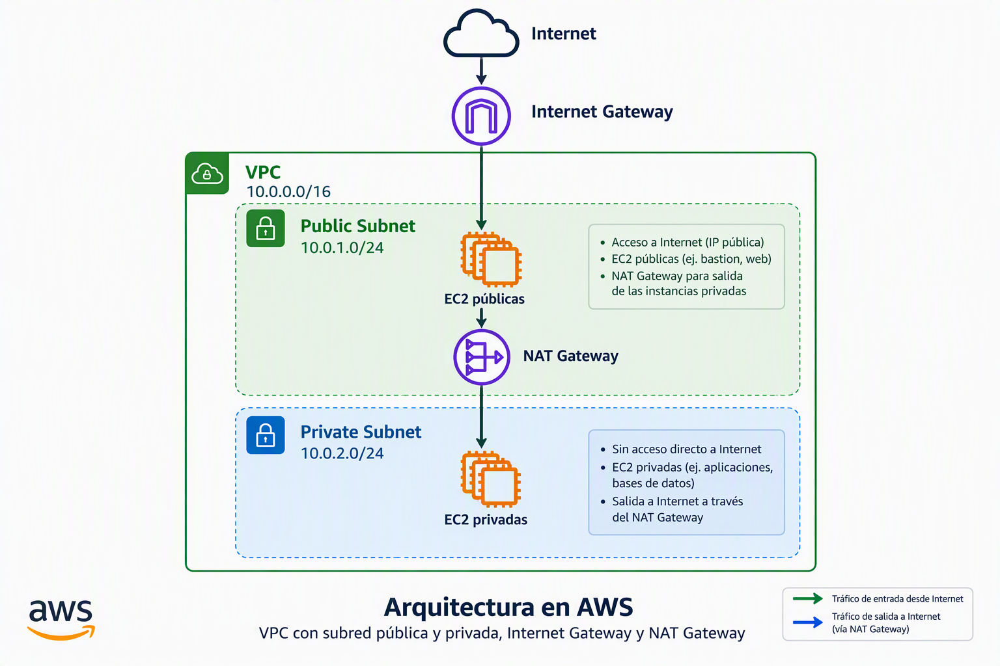

# Prácticas UD3

Dentro de esta sección vamos a detallar las prácticas de la unidad didáctica 3 en la que trabajaremos administrando almacenamiento de bloques y ficheros. 

## Consideraciones comunes a todas las prácticas

### La variable $username

Recuerda que cuando pongamos `$username` en el nombre sustituimos por `abdan-` + la primera letra de nuestro nombre (si tenemos varios nombres, sólo usaremos la primera letra del primer nombre), primera letra del apellido y segundo apellido completo (si no tienes segundo apellido, pon el primer apellido completo). Por ejemplo, en mi caso que soy Rafael González Centeno `$username = abdan-rgcenteno`Esto permitirá ver la autoría de las prácticas y que no choquen los nombres de los recursos en las prácticas que hagáis en el entorno real.

### Plantilla CloudFormation que crea una VPC con subred pública y subred privada



[Enlace al yaml](files/vpc-abdan.yaml)

En la sección `Parameters` puedes cambiar el nombre de la VPC y de las subredes creadas así como los CIDR de cada una de ellas.

Puedes revisar la sección Comandos CF para ver como operar con la plantilla.

```yaml
AWSTemplateFormatVersion: "2010-09-09"
Description: >
  VPC con 1 subred publica y 1 privada en la misma AZ, Internet Gateway,
  NAT Gateway con Elastic IP y tablas de rutas publica y privada.

####################################
# PARAMETROS
####################################
Parameters:
  VpcName:
    Type: String
    Default: vpc-abdan
  VpcCidr:
    Type: String
    Default: 10.0.0.0/16

  PublicSubnetName:
    Type: String
    Default: PublicSubnet
  PublicSubnetCidr:
    Type: String
    Default: 10.0.1.0/24

  PrivateSubnetName:
    Type: String
    Default: PrivateSubnet
  PrivateSubnetCidr:
    Type: String
    Default: 10.0.2.0/24


Resources:

  ####################################
  # VPC (con DNS habilitado)
  ####################################
  VPC:
    Type: AWS::EC2::VPC
    Properties:
      CidrBlock: !Ref VpcCidr
      EnableDnsSupport: true
      EnableDnsHostnames: true
      Tags:
        - Key: Name
          Value: !Ref VpcName

  ####################################
  # SUBRED PUBLICA (AZ 1)
  ####################################
  PublicSubnet:
    Type: AWS::EC2::Subnet
    Properties:
      VpcId: !Ref VPC
      CidrBlock: !Ref PublicSubnetCidr
      AvailabilityZone: !Select [0, !GetAZs ""]
      MapPublicIpOnLaunch: true
      Tags:
        - Key: Name
          Value: !Ref PublicSubnetName

  ####################################
  # SUBRED PRIVADA (AZ 1)
  ####################################
  PrivateSubnet:
    Type: AWS::EC2::Subnet
    Properties:
      VpcId: !Ref VPC
      CidrBlock: !Ref PrivateSubnetCidr
      AvailabilityZone: !Select [0, !GetAZs ""]
      Tags:
        - Key: Name
          Value: !Ref PrivateSubnetName


  ####################################
  # INTERNET GATEWAY
  ####################################
  InternetGateway:
    Type: AWS::EC2::InternetGateway
    Properties:
      Tags:
        - Key: Name
          Value: !Sub "${VpcName}-igw"

  InternetGatewayAttachment:
    Type: AWS::EC2::VPCGatewayAttachment
    Properties:
      VpcId: !Ref VPC
      InternetGatewayId: !Ref InternetGateway

  ####################################
  # ROUTE TABLE PUBLICA
  ####################################
  PublicRouteTable:
    Type: AWS::EC2::RouteTable
    Properties:
      VpcId: !Ref VPC
      Tags:
        - Key: Name
          Value: !Sub "${VpcName}-public-rt"

  PublicDefaultRoute:
    Type: AWS::EC2::Route
    DependsOn: InternetGatewayAttachment
    Properties:
      RouteTableId: !Ref PublicRouteTable
      DestinationCidrBlock: 0.0.0.0/0
      GatewayId: !Ref InternetGateway

  PublicSubnetRouteTableAssociation:
    Type: AWS::EC2::SubnetRouteTableAssociation
    Properties:
      RouteTableId: !Ref PublicRouteTable
      SubnetId: !Ref PublicSubnet

  ####################################
  # EIP + NAT GATEWAY
  ####################################
  NatEIP:
    Type: AWS::EC2::EIP
    DependsOn: InternetGatewayAttachment
    Properties:
      Domain: vpc
      Tags:
        - Key: Name
          Value: !Sub "${VpcName}-nat-eip"

  NatGateway:
    Type: AWS::EC2::NatGateway
    Properties:
      SubnetId: !Ref PublicSubnet
      AllocationId: !GetAtt NatEIP.AllocationId
      Tags:
        - Key: Name
          Value: !Sub "${VpcName}-nat"

  ####################################
  # ROUTE TABLE PRIVADA
  ####################################
  PrivateRouteTable:
    Type: AWS::EC2::RouteTable
    Properties:
      VpcId: !Ref VPC
      Tags:
        - Key: Name
          Value: !Sub "${VpcName}-private-rt"

  PrivateDefaultRoute:
    Type: AWS::EC2::Route
    Properties:
      RouteTableId: !Ref PrivateRouteTable
      DestinationCidrBlock: 0.0.0.0/0
      NatGatewayId: !Ref NatGateway

  PrivateSubnetRouteTableAssociation:
    Type: AWS::EC2::SubnetRouteTableAssociation
    Properties:
      RouteTableId: !Ref PrivateRouteTable
      SubnetId: !Ref PrivateSubnet


####################################
# SALIDAS (equivalente al RESUMEN)
####################################
Outputs:
  VpcId:
    Value: !Ref VPC
    Export:
      Name: !Sub "${AWS::StackName}-VpcId"
  InternetGatewayId:
    Value: !Ref InternetGateway
  PublicSubnetId:
    Value: !Ref PublicSubnet
    Export:
      Name: !Sub "${AWS::StackName}-PublicSubnetId"
  PrivateSubnetId:
    Value: !Ref PrivateSubnet
    Export:
      Name: !Sub "${AWS::StackName}-PrivateSubnetId"
  PublicRouteTableId:
    Value: !Ref PublicRouteTable
  PrivateRouteTableId:
    Value: !Ref PrivateRouteTable
  ElasticIpAllocationId:
    Value: !GetAtt NatEIP.AllocationId
  NatGatewayId:
    Value: !Ref NatGateway
```
